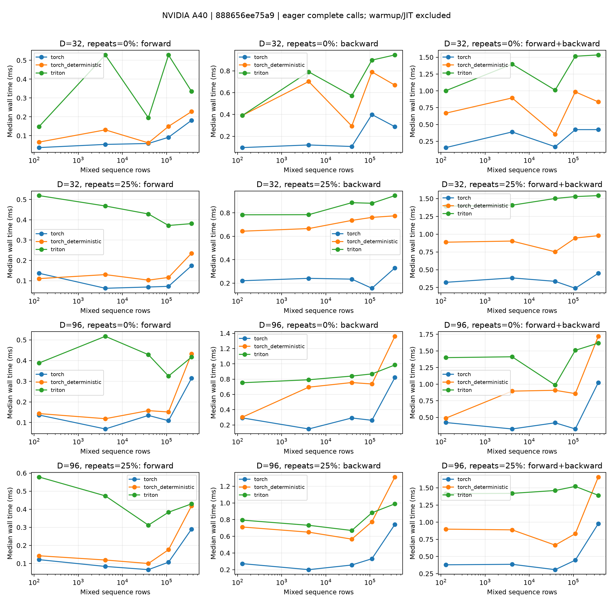

# MiniMax-H3 Packed Index Select

`packed_index_select` implements the output-selection row of
[RFC #420](https://github.com/RL-Align/RL-Kernel/issues/420):

```text
y[b, j, d] = x[b, index[j], d]
```

The pinned [Diffusers H3 forward](https://github.com/huggingface/diffusers/blob/f53d552036a0d1bd5570782a39cd40cfabf112bc/src/diffusers/models/transformers/transformer_minimax_h3.py#L622-L627)
projects **every mixed-sequence row** through both heads, then calls
`.index_select(1, video_indices)` and `.index_select(1, audio_indices)`.
The checkpoint keeps both heads in FP32. Their output widths are 96 and 32;
the 5376-wide hidden stream is not the input to this selection boundary.
The same index vector applies independently to every batch item.

## Entry point and scope

```python
from rl_engine.runtime.registry import kernel_registry

select = kernel_registry.get_op("packed_index_select", device=projected.device)
video_output = select(projected, video_indices)  # [B, K_video, 96]
```

See the runnable [example](https://github.com/RL-Align/RL-Kernel/blob/test-h3/examples/models/minimax_h3/packed_index_select.py)
for both heads and autograd. This PR supplies an operator and registry binding;
it does not patch a Diffusers model or claim full-transformer acceptance.
The merged [video output projection #646](https://github.com/RL-Align/RL-Kernel/pull/646)
remains a separate operator. No projection/gather fusion or parameter-gradient
canonicalization is introduced here.

The current `h3_full_model._strict_boundaries` adapter replaces projection
modules and the text refiner; the provider still executes its tensor-method
output selection. Wiring this operator into that full-model path is a separate
integration step and must report both selection calls in the model trace.

**Validation status:** CUDA compilation and all 31 device cases passed on an
NVIDIA A40 (SM86), using PyTorch 2.8.0+cu128 and Triton 3.4.0. The operator,
registry, unified-input/checker and dispatch suite passed all 130 cases with
no skips. The SM80+ device guard defines eligibility; other architectures have
not been measured. ROCm has not been tested and is not registered. Production dispatch fails closed on unsupported platforms or
an unavailable Triton backend; the Native reference must be requested explicitly.

## Tensor contract

| Value | Shape | Requirements |
| --- | --- | --- |
| `x` | `[B, S, D]` | FP32, FP16 or BF16; strided views accepted |
| `index` | `[K]` | int32 or int64, same device as x, values in `[0, S)` |
| output | `[B, K, D]` | Contiguous, x's dtype, indices in their supplied order |
| upstream gradient | `[B, K, D]` | Strided and expanded views accepted |
| input gradient | `[B, S, D]` | Contiguous, x's dtype; unselected rows are positive zero |

Duplicates are legal and retain multiplicity. Normal modality selection has
distinct rows; duplicate support is an explicit extension of that use case,
with the same mathematical VJP as `index_select`. Indices are semantic inputs,
not sortable output order. They cannot be modified between forward and backward.

Empty dimensions follow the selection formula: `K=0` returns an empty output
and a zero input gradient; `S=0` requires `K=0`; empty batch or feature axes
produce empty tensors. Indices are still range-checked when B or D is zero.
Negative indices do not wrap. Metadata errors fail synchronously. CUDA range
errors use an asynchronous device assertion, so they should be isolated in a
subprocess when testing invalid input; the device context may become unusable.
There is no unchecked public entry point.

Only first-order autograd is supported. Higher-order gradients, distributed
selection, compilation/export and CUDA Graph capture are not qualified.

## Arithmetic and invariance

Forward only loads and stores values, without dtype conversion or arithmetic.
For backward, let `j0 < j1 < ... < jm` be the supplied output positions whose
index equals source row `s`. For every `(b, s, d)` independently:

```text
a = FP32(+0)
a = round_fp32(a + FP32(grad[b, j0, d]))
a = round_fp32(a + FP32(grad[b, j1, d]))
...
dx[b, s, d] = cast_to_input_dtype(a)
```

The stable integer sort preserves this occurrence order. A single CTA owns
each `(batch, source row, channel tile)` and reads the upstream tensor using
its actual strides. Other CTAs for the same segment exit without writing.
There are no floating-point atomics, split reductions or sums across batches.
The initial zero addition is part of the contract, including its signed-zero
behavior. FP16/BF16 round only at the final store after FP32 accumulation.

The intended exact comparisons preserve the values and occurrence order of
each source row: repeat calls, training/inference forward, batch placement,
batch permutation/splitting, checkpoint replay, and consistent relabeling of
input rows with their index mapping. Unrelated batch rows cannot alter a VJP.
Arbitrary reordering of **duplicate output occurrences**, or splitting their
sum across separate backward calls, can change FP32 rounding. No exact claim
is made for those transformations. Sequential FP32 summation is also not
exact real arithmetic: severe cancellation can differ from FP64; the fixed
arithmetic contract and numerical accuracy are separate checks.

## Reuse and integration

| Existing component | Decision |
| --- | --- |
| Triton embedding | Reuse stable grouping and exclusive segment ownership as the algorithm. Its 2-D table gradient merges token occurrences across batches; this VJP must keep B independent. Calling it would require flattening/relabeling and copying gradients. Keep the small strided kernels local. |
| H3 AdaLN row gather | Different six-chunk table interface and a 256-position tiled reduction. Reusing it would change this sequential rounding order and require the CUDA extension. |
| Mask packing | Different selection metadata and ragged output layout; not a direct substitute. |
| Runtime registry / unified checker | Register `packed_index_select`, strict backend `triton-packed-index-select`, WS1 topology and concrete implementation identity. Record the actually executed backward through `record_backward`. |

`NativePackedIndexSelectOp.forward` is a readable executable contract:
PyTorch gather, then CPU FP32 additions in increasing output position.
`forward_fp32` is the independent accuracy path: FP32 gather with a CPU FP64
`index_add_` VJP, rounded to the input leaf's dtype. Accuracy tests use FP32
leaves for this reference so low-precision candidate gradients are compared
against an unrounded FP32 oracle. Neither reference path is a timing baseline.

## Reproduce validation

From the checkout, with project dependencies installed:

```bash
export PYTHONPATH=.
python -m pytest -q tests/models/minimax_h3/test_packed_index_select.py
python -m pytest -q tests/runtime/test_kernel_registry.py \
  tests/validation/operators/test_operator_inputs.py -k packed_index_select
python tools/validation/operators/check_operator.py \
  --op packed_index_select --candidate triton --device cuda --dtype fp32 \
  --batch 2 --seq 129 --n-dim 96 --check-grad --grad-mode random
```

The tests separately check forward bits, ordered-gradient bits, independent
accuracy under the existing WS1 `gradient_accuracy/reduction` tolerances,
invariance, invalid indices and device rejection. Shapes include widths
32/96, tail widths, 38,734/110,750/367,986 mixed rows, empty axes, strided
indices/inputs/gradients and repeated destinations. Local CPU tests do not
qualify CUDA, and skipped device tests are not passes.

For CPU-only validation select `-k TestReference`; the unified checker also
accepts `--candidate pytorch --device cpu`. No CUDA extension is needed for
this Triton implementation. Record the actual torch/Triton/driver versions
alongside each GPU validation run. The measured environment is listed below.

## Benchmark and evidence

```bash
timeout 1200 python benchmarks/operators/embedding/benchmark_packed_index_select.py \
  --rows 129 4097 38734 110750 367986 --widths 32 96 \
  --duplicates 0 0.25 --dtype float32 --batch 1 --warmup 5 --samples 30 \
  --output artifacts/packed-index-select/benchmark.json
python benchmarks/operators/embedding/plot_packed_index_select.py \
  artifacts/packed-index-select/benchmark.json \
  --output artifacts/packed-index-select/latency.png
```

The timeout command above is GNU `timeout` on the GPU Linux host. Plotting
requires Matplotlib and consumes measured JSON only.

The ordinary `torch.index_select` + autograd baseline uses deterministic mode
**off**; a second PyTorch baseline uses it **on**. The candidate is timed with
it off, and tests compare both settings. All modes measure eager forward,
backward, and forward+backward with allocations, wrapping, range validation,
zero initialization and stable sorting included in their owning phase.
Backward uses a retained forward graph; combined calls construct fresh graphs.
Input creation, reference calculations, JIT compilation and warmups are excluded.
No `.grad` buffer is repeatedly accumulated. CPU wall times include end
synchronization; CUDA-event times also include dispatch gaps between kernels.

All elements are checked against the CPU FP64 VJP before timing. Repeat-bit
mismatches and any native accuracy failures are recorded too. Candidate
failures produce a nonzero exit and remain in JSON. JSON records raw samples,
timing medians, incremental peak allocation, deterministic-mode settings,
source hashes, Git revision/dirty status, GPU, driver, torch and Triton versions.
The baseline order is fixed within each case; compare device clocks and rerun
before interpreting small latency differences.

The benchmark uses H3 widths and realistic mixed-row counts but selects a
synthetic half of the rows. Repeat fractions stress the general contract;
they are not claims about production modality distributions. These are
operator measurements, not end-to-end model throughput. Large-repeat segments
have a sequential dependency and can be slow. Raw evidence belongs in ignored
`artifacts/packed-index-select/` and an external download bundle, not Git.

### A40 measurements (2026-11-05)

Measured revision: `888656ee75a9ea307a86085ee26d4a461d33a3e8`, clean checkout.
Single NVIDIA A40 / SM86, driver 595.91.07, Python 3.12.3,
PyTorch 2.8.0+cu128, CUDA runtime 12.8, Triton 3.4.0. No CUDA extension
was built or required. The initial backward compilation failed on Triton's
unsupported `break`; replacing it with a masked next-row load and a loop
condition preserved the declared sequential arithmetic and passed the suite.

- 130 pytest cases passed, including all 31 CUDA cases, with no skips.
- Six unified-checker runs passed: B=2, S=129, D=32/96, random VJP,
  FP32/FP16/BF16. The two-head registry example also ran successfully.
- The main matrix has 20 cases per dtype: B=1, S=129/4097/38734/110750/367986,
  D=32/96, repeat fractions 0/25%, for all three dtypes. Eight FP32 stress
  cases use B=2, S=129/4097, D=32/96 and repeat fractions 75/99%.
- All 68 candidate cases passed all-element forward-copy bits, gradient
  accuracy and repeated forward/gradient bits. Thresholds were unchanged.
  Maximum absolute gradient error was 0 for the main FP32 matrix,
  0.001953125 for FP16, 0.015625 for BF16, and 1.335145e-5 for FP32 stress.
  These errors passed their combined absolute/relative tolerances.
- Ordinary PyTorch had gradient repeat-bit mismatches in all eight stress
  cases; its accuracy checks passed. PyTorch deterministic mode and Triton
  had no repeat-bit mismatches. Each benchmark repeat check compares two VJPs;
  the focused CUDA suite additionally repeats selected VJPs three times.

Repeat the main benchmark command above with `--dtype float16` and
`--dtype bfloat16`, using separate output files. The stress run is:

```bash
timeout 600 python benchmarks/operators/embedding/benchmark_packed_index_select.py \
  --rows 129 4097 --widths 32 96 --duplicates 0.75 0.99 \
  --dtype float32 --batch 2 --warmup 5 --samples 30 \
  --output artifacts/packed-index-select/benchmark-b2-repeats.json
```

Median synchronized forward+backward wall time (ms), B=1, S=367986, FP32,
K=183993; 5 warmups and 30 measured samples per implementation and phase:

| D | Repeats | PyTorch | PyTorch deterministic | Triton |
| --- | --- | --- | --- | --- |
| 32 | 0% | 0.4235 | 0.8358 | 1.5343 |
| 32 | 25% | 0.4495 | 0.9790 | 1.5421 |
| 96 | 0% | 1.0249 | 1.7200 | 1.6175 |
| 96 | 25% | 0.9785 | 1.6581 | 1.3911 |

The candidate is **slower than ordinary PyTorch in every measured case**.
Across the 20 main FP32 cases its combined wall-time ratio to ordinary
PyTorch is 1.42–6.41 (median 3.67); relative to deterministic PyTorch it is
0.84–2.86 (median 1.58). This establishes a fixed-order implementation, not
a general speedup. The small advantages over deterministic PyTorch in the
largest D=96 cases are single-run observations, not a robust optimization
claim. Host dispatch and synchronization are included, the baseline order is
fixed, and shared-host noise is visible in the nonmonotonic timings.

For S=367986, D=96, 0% repeats, incremental peak allocation during combined
execution was 202.14 MiB (PyTorch), 278.52 MiB (deterministic PyTorch) and
209.74 MiB (Triton). This is allocation above live inputs/retained graph,
not total GPU or model memory. Full phase medians, memory, checks, environment,
source fingerprints and raw-file hashes are in the compact
[measurement summary](../assets/benchmarks/h3-packed-index-select-a40/summary.json).
Raw per-sample JSON and logs are retained outside Git.



The nondefault-stream test passed on this one-device host; changing the
current device while targeting another GPU remains untested. These results
do not qualify other architectures, ROCm, CUDA Graph capture, higher-order
autograd, full-model output-selection binding or model-level trajectories.
