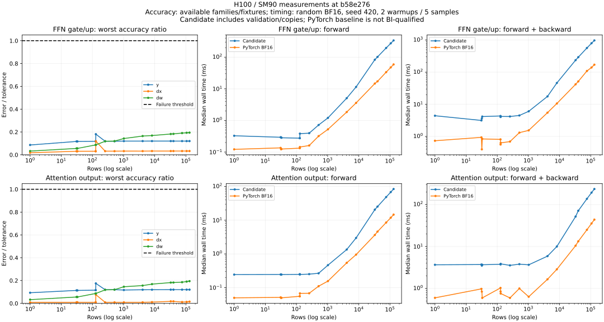

# H3 gate/up and attention output projections

CUDA WS1 candidates for `h3_ffn_gate_up_gemm` and `h3_attention_o_gemm` in
[issue #420](https://github.com/RL-Align/RL-Kernel/issues/420).
Checkpoint: `MiniMaxAI/MiniMax-H3@42ed227ee7df40d41602854ae760620d6eb651fe`.

| Operator | Input width | Output width | Native block-0 weight |
| --- | ---: | ---: | --- |
| FFN gate/up | 5376 | 28672 | `ff.net.0.proj.weight` |
| Attention output | 7168 | 5376 | `attn.to_out.0.weight` |

Both accept BF16 `[M,K]` or `[B,S,K]`, native `[N,K]` weights and no bias.
Gate/up returns the packed projection in checkpoint row order without a SwiGLU
activation or row permutation. Attention output consumes flattened 56 x 128
head channels in their original order. The candidate input range is now 1 to 131072 rows; the expansion is not yet GPU-qualified.
One NVIDIA SM90 device, eager execution and TF32 disabled are required.

The shared adapter reuses `_det_gemm_fp32_kernel` with fixed 64x64x32 tiles,
four warps, two stages, no fusion, no autotuning and no split-K. Each 32-wide
BF16 dot tile produces FP32; tile sums are added in increasing K order and
cast to BF16 once. Forward, dX and dW use the same arithmetic policy.
There is no fallback and no newly introduced device kernel. Registry entries
remain test-only, with `gpu_qualified=false` until reviewed GPU qualification.
This separate branch has no dependency on unmerged PR #535 and imports none of
its historical GPU evidence. Common code can be consolidated when both land.

```python
import torch
from rl_engine.ops.gemm.h3_projections import H3FFNGateUpGemmOp, H3AttentionOGemmOp
from rl_engine.ops.autograd.canonical_backward import canonical_backward_session

torch.backends.cuda.matmul.allow_tf32 = False
op = H3FFNGateUpGemmOp()  # Use H3AttentionOGemmOp for attention output.
with canonical_backward_session() as session:
    y = op(x, weight, logical_keys=keys, parameter_id="block0.ff.gate_up.weight")
    y.backward(dy)
    session.validate_complete()
```

Training with weight gradients requires one session spanning all forward uses
and one backward call. Int64 keys `[rows,2]` or `[rows,3]` must identify unique
active logical rows; a negative first component marks padding with zero dY.
The same parameter must retain one weight Tensor and one stable name. dW rows
are sorted canonically, zero-padded to a multiple of 32 and reduced once.
Repeated accumulation, retained-graph replay, double backward, graph compilation,
TP and full-model integration are outside this candidate's contract.

## Local validation and GPU qualification

CPU tests cover contracts, session ordering, chunks, permutations, padding,
partial gradients, non-contiguous version counters, fail-closed registry
resolution, reference math, fixture byte ranges and runner orchestration.
CPU surrogates exercise control flow only; they do not emulate GPU arithmetic.
The H100 run at source revision
`6a50c80d3d226188281c9acb166b6f6e9c55b077` passed 45 tests, all 8 smoke
cases, all 80 full-matrix cases (1,868 checks), and all 12 replay cases.
The 36 y/dX/dW digests matched across separate processes and compilation caches.
Both operators passed 40 full cases and 934 checks each. The maximum error
normalized by the applicable tolerance was 0.182174; all invariance checks
passed with zero differing elements. Explicit execution traces recorded the
requested Triton backend with no fallback.

The machine used one H100 80GB (SM90) and an Intel Xeon Platinum 8470 CPU.
Software was Python 3.10.12, PyTorch 2.6.0+cu124, Triton 3.2.0 and driver
580.126.09. The optional global core extension was unavailable; its import-time
warning does not describe these operators, whose actual kernel/cubin traces
are retained. Registry entries remain test-only pending broader qualification.

Use one non-MIG H100 80GB, at least 16 CPU cores, 64GB host RAM and 100GB free
storage. A CUDA 12.4 environment with Python 3.10 is the primary test profile:

```bash
python3.10 -m venv .venv
source .venv/bin/activate
python -m pip install torch==2.6.0 --index-url https://download.pytorch.org/whl/cu124
python -m pip install -r requirements/h3-projections.txt
export H3_EVIDENCE_DIR="${PWD}/artifacts/h3-projections"
bash ci/scripts/run_h3_projections.sh smoke
bash ci/scripts/run_h3_projections.sh full
bash ci/scripts/run_h3_projections.sh replay
```

The full matrix covers both operators, 13 row counts from 1 through 32768 and
random, normalized and cancellation inputs: 78 synthetic cases plus two real
checkpoint-weight cases. Fixture activations are explicitly synthetic. The
range downloader retrieves only the two required tensors and records revision,
weight key and weight/index/header digests. It rejects ignored or malformed
HTTP ranges. Captured model inputs remain an additional integration qualification target.

Each case checks independent FP32 y/dX/dW accuracy from identical BF16 inputs,
repeat, row permutation, chunk size 31, non-contiguous layout, inactive padding,
batch reshaping, singleton rows and mutation of unrelated rows. Published shared
tolerances are used unchanged; NaN/Inf and signed-zero differences fail invariance.
Synchronized wall timings include host checks, copies and canonical preparation;
GPU peak allocation and every sample are retained. Ordinary PyTorch BF16 is a
performance comparator, with no assumed byte-invariance qualification.
Fresh-process replay uses a separate compilation cache and compares all three
output digests. Reports retain actual JIT/cubin identity, source hashes and
software versions. Hardware identity is limited to necessary device facts.

Raw reports, fixture tensors, caches and operational details remain outside the
submission. Before publication, review and consolidate measured results into
one essential JSON bundle per device/run, preserving all failures and recording
original hashes and any sanitization. Never label skipped tests or this local
preparation as GPU acceptance, performance improvement or production readiness.

## Measured performance and evidence

Median synchronized wall times in milliseconds, random BF16 inputs with seed
420 and 32,768 rows; two warmups and five measured repetitions:

| Operator | Candidate forward | PyTorch BF16 forward | Candidate forward/backward | PyTorch BF16 forward/backward |
| --- | ---: | ---: | ---: | ---: |
| Gate/up | 83.1829 | 16.4246 | 234.6838 | 45.3069 |
| Attention output | 20.6235 | 3.4305 | 49.5236 | 12.7178 |

The candidate is slower than ordinary PyTorch BF16 in these measurements.
The baseline has no byte-invariance qualification, and the candidate timing
includes validation, copies and canonical gradient preparation. All row counts,
raw timing samples, memory measurements, tolerances, correctness metrics,
fixture provenance, output hashes and kernel traces are retained in
[`evidence/h3-projections/h100.json`](evidence/h3-projections/h100.json).
Verify the bundle with `sha256sum -c SHA256SUMS` from its directory.

The bundle is a reviewed derivative with original artifact hashes. Its JSON
report contents are unchanged; the pytest summary is explicitly extracted
from the smoke log. Raw originals, weights and compiled artifacts remain
outside the submission; all 170 retrieved files passed integrity checks.
The historical evidence commit changed no implementation. Subsequent local changes
expand the row limit, enable 64-bit addressing and extend validation; the historical
results do not qualify those changes. New GPU evidence is required before publication.

Real weights were tested with synthetic activations. Captured model inputs,
independent-environment replay, full-model integration and TP remain untested.
The report's `acceptance_complete` stays false. These operator results do not
establish production readiness or a performance improvement.


## Reuse assessment

Reviewed on 2026-10-14. This is a source/API assessment, not an external-backend
GPU benchmark or proof that alternative kernels fail batch invariance.

| Candidate and source | Assessment and decision |
| --- | --- |
| RL-Kernel `_det_gemm_fp32_kernel` | Reused directly. Fixed tiles and ordered K accumulation already match the arithmetic policy. The adapter supplies native weight layout, backward and canonical logical-row reduction. The large-row extension selects 64-bit offsets; default callers retain their existing index policy. |
| [CUTLASS GEMM 3.x](https://docs.nvidia.com/cutlass/latest/media/docs/cpp/gemm_api_3x.html) | Provides configurable GEMM collectives and schedules. A fixed schedule is a plausible alternative, but does not itself supply this operator's canonical cross-call dW/session contract. No replacement is qualified here. |
| [FlashInfer GEMM](https://docs.flashinfer.ai/api/gemm.html) | BF16 GEMM is a relevant comparator. Its API availability alone does not establish the required forward/dX/dW invariance under row permutations and chunked training. No external comparison was run. |
| [SGLang persistent GEMM](https://github.com/sgl-project/sglang/blob/bab9c81fea62c2d20b646736c918c88fea54b7a2/python/sglang/srt/batch_invariant_ops/batch_invariant_ops.py) | The inspected BF16 configuration uses 128x128x64 tiles and a persistent schedule. It is a credible BI reuse candidate, with a different reduction policy from this 64x64x32 profile; canonical training reduction still needs an adapter and qualification. Keep as a future performance comparator rather than claiming it is unsuitable. |
| [vLLM batch invariance](https://docs.vllm.ai/en/latest/features/batch_invariance/) | Inference batch invariance is relevant prior art. This training operator additionally needs stable logical keys and canonical dW across calls. Inference qualification is not evidence for that contract. |
| [FlashAttention](https://github.com/Dao-AILab/flash-attention) | Attention is adjacent to the output projection; it is not a replacement for these dense linear maps. |
| [Miles](https://github.com/radixark/miles), [Verl](https://github.com/verl-project/verl), [Vime reproducibility](https://github.com/vllm-project/vime/blob/main/docs/en/advanced/reproducibility.md) | Framework integration and reproducibility guidance inform system testing. No standalone H3 training projection implementation was established by this review; backend-level candidates above remain the relevant comparison points. |

Reuse of the existing repository kernel avoids adding another device kernel or
an unqualified dependency. This decision makes no speed advantage claim over
CUTLASS, FlashInfer, SGLang or vLLM.

## Historical accuracy and performance charts



The chart is derived solely from the unchanged JSON bundle: worst error divided
by tolerance for y/dX/dW over all families at each synthetic row count, and
median forward/forward-backward wall times for random inputs. It does not cover
the expanded row range or the current 64-bit index variant. Reproduce with:

```bash
python -m pip install matplotlib==3.10.9
python benchmarks/operators/gemm/plot_h3_projections.py \
  --evidence docs/operators/evidence/h3-projections/h100.json \
  --output docs/operators/evidence/h3-projections/h100.svg
```

## Task-shaped acceptance still to run

The earlier 32768-row ceiling was below a realistic 768p task. Geometry follows
pinned diffusers v0.40.0
[frame conversion](https://github.com/huggingface/diffusers/blob/v0.40.0/src/diffusers/modular_pipelines/minimax_h3/modular_pipeline.py)
and [packed sequence construction](https://github.com/huggingface/diffusers/blob/v0.40.0/src/diffusers/modular_pipelines/minimax_h3/before_denoise.py):
`T = ((F - 5) // 17) * 5 + 2`, video rows `T * 24 * 42`, stereo audio rows
`2 * round(F / 24 * 40)`. The fixture explicitly selects 256 text rows and two
keyframes (2016 conditioning rows). These are task-shaped synthetic inputs,
not captured model activations. No full model is required to exercise these
row-local GEMMs and their canonical weight gradients.

| Frames | Latent frames | Video rows | Audio rows | Total packed rows |
| ---: | ---: | ---: | ---: | ---: |
| 124 | 37 | 37296 | 414 | 39982 |
| 243 | 72 | 72576 | 810 | 75658 |
| 345 | 102 | 102816 | 1150 | 106238 |

The largest declared task fixture is 345 frames, B=1, 1344x768; the 131072-row
boundary is also tested separately. This is not a claim to cover every aspect
ratio, prompt length, reference count or larger batch. Device fit and correctness
are pending GPU measurement. OOM or numerical failures must remain in evidence.
Long cases use non-divisible chunks of 4093 rows; historical-sized cases retain
31-row chunks. Byte mismatch counts are accumulated in bounded chunks to avoid
an unnecessarily large temporary during long-case verification.

```bash
bash ci/scripts/run_h3_projections.sh smoke
bash ci/scripts/run_h3_projections.sh full
bash ci/scripts/run_h3_projections.sh tasks
bash ci/scripts/run_h3_projections.sh tasks-replay
```

Both task runs exercise 32768, 131072 and all three packed row counts for both
operators, plus checkpoint fixtures; replay uses a fresh process/cache and
compares all output digests. Run the full historical matrix again because the
index specialization changed. The new task runs currently use random inputs;
normalized/cancellation coverage remains in the full regression matrix.

Negative tests now explicitly cover mixed-device inputs/keys, malformed key
shape/dtype/count, duplicates, session row overflow and unsupported registry
WS/TP combinations. Direct eager calls are local operators and do not negotiate
distributed topology; distributed callers must use the strict registry. Existing
coverage includes empty/wrong-dtype inputs, unsupported devices/backends,
non-contiguous inputs, padding gradients and stale autograd versions.

Publication is blocked pending new GPU results for the changed source. The
personal pre-push profile retains the historical source/evidence hashes until
new evidence has been reviewed; it must not be repinned merely to pass the gate.
