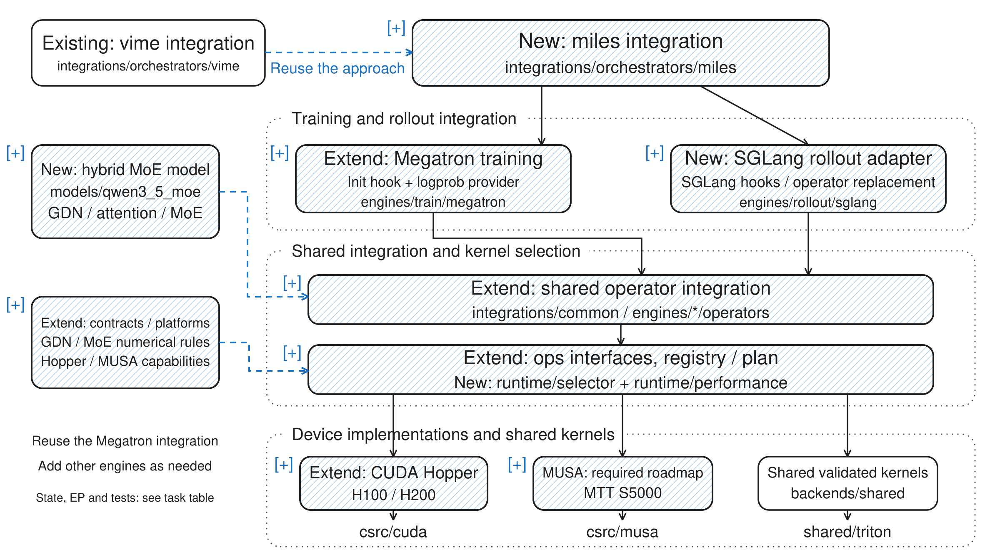
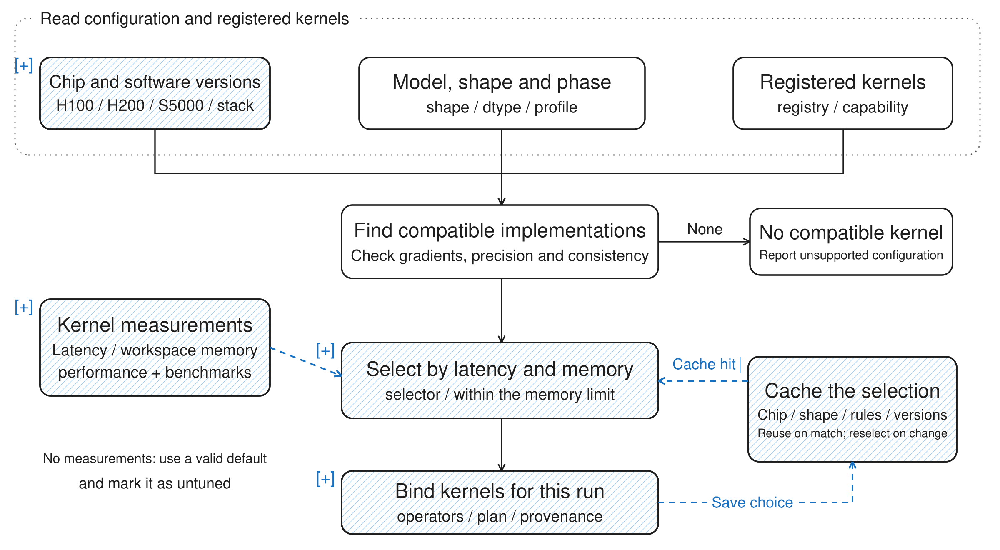
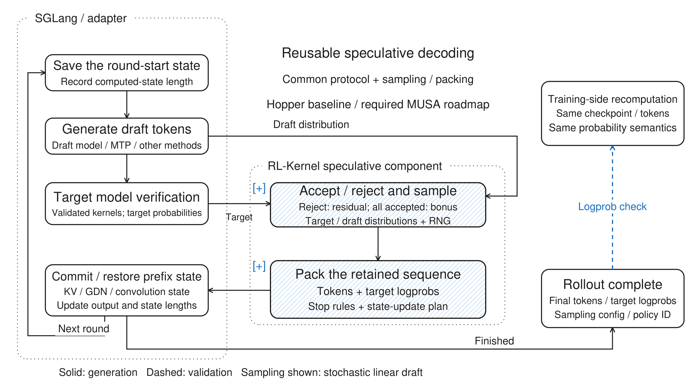
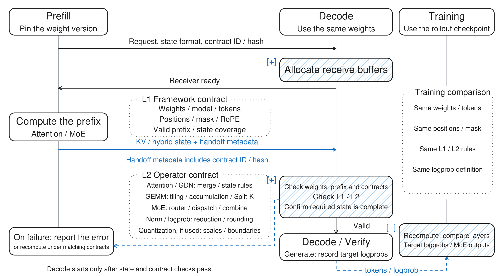
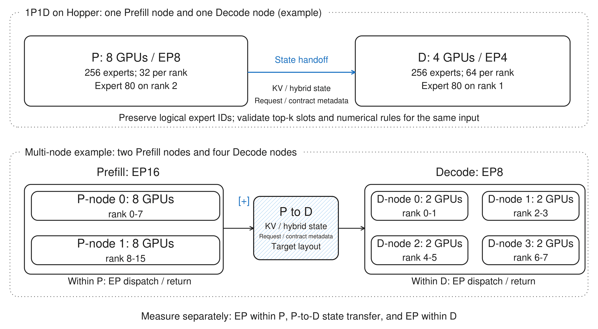
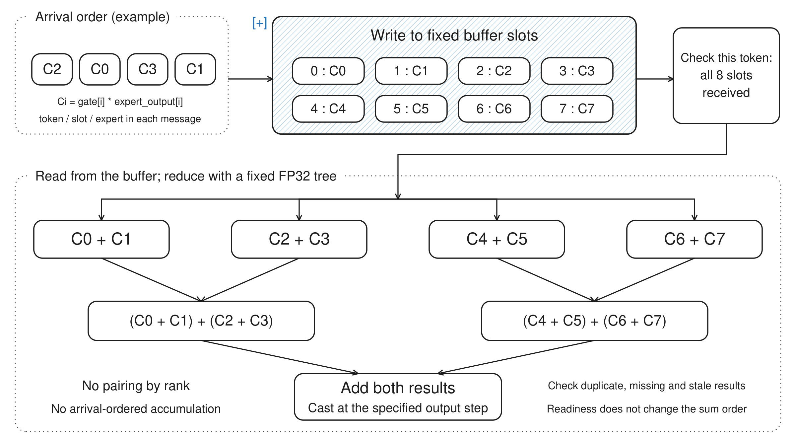

# [RFC] miles + RL-Kernel + Qwen3.6 Series MoE on NVIDIA Hopper

## 1. Development sequence

Target Qwen/Qwen3.6-35B-A3B with miles, Megatron training and SGLang rollout. **Hopper is the first implementation baseline; the required Moore Threads delivery is defined in the MUSA roadmap below.** The scope is full-model BF16 text-only RL, with **bitwise training/rollout consistency on both single-node multi-GPU and multi-node multi-GPU deployments**, including declared cross-configuration comparisons. A single-node pass or a Hopper-only pass does not complete the target-hardware delivery. Optimize memory and complete RL-iteration time without relaxing numerical acceptance.

- **Freeze the model and Hopper stack.** Pin weights, tokenizer, CUDA, compiler and engine revisions; record the actual hardware and capacity plan.
- **Reproduce native miles.** Run ordinary decode, training forward/backward, one optimizer update and rollout with refreshed weights. Keep the upstream MTP recipe as a separate comparison.
- **Build numerical coverage.** Validate existing CUDA operators and add missing MoE and GDN functionality. Start with a four-layer structural fixture, then the full 40-layer checkpoint.
- **Connect Megatron and SGLang.** Share numerical contracts and independently recompute retained-token logprobs at fixed weights.
- **Validate distributed coverage.** Test single-node multi-GPU first, then multi-node multi-GPU; compare matching logical tokens across node counts, batch/chunk sizes and supported TP/PP/CP/EP layouts. Validate each board/software stack independently.
- **Extend rollout.** Add speculative decoding and P/D disaggregation behind separate acceptance gates.
- **Complete the required MUSA roadmap.** Reuse shared model, operator and integration contracts; implement and validate device-specific paths. Finish full-model single-node and multi-node strict checks plus same-hardware performance acceptance before declaring the Moore Threads delivery complete.

Section 10 contains **72 work packages in one table**. Reuse means integrate and validate existing code; Extend means add missing coverage or interfaces; New means implement missing functionality. Labels describe work, not completed support. Owners remain unassigned.

### Hopper hardware and milestones

- **H200: 8 × 141 GB preferred.** Primary bring-up configuration, matching the upstream miles recipe's device family. First reproduce that recipe, then establish the ordinary-decode consistency profile.
- **H100 SXM: 8 × 80 GB preferred.** Required follow-on Hopper capacity and performance coverage. Size its configuration independently; an H200 run does not establish H100 fit.

Both are Hopper devices [NVIDIA hardware table][nv-hardware]. Record the exact board, memory, topology and node allocation; these preferred configurations are planning targets, not measured capacity results.

- **G0 - Reproducible Hopper environment.** Tasks 1, 3, 7 and 8: model conversion, dependency imports, device visibility, source pins and resource budgets.
- **G1 - Native functional baseline.** Task 5: ordinary BF16 full-model rollout, backward/update and successful post-update rollout. No bitwise claim yet.
- **G2 - Operators and model assembly.** Tasks 9–49: basic operators, GDN, attention, MoE, distributed algorithms and adapters. Accuracy/gradient checks and full-model weight mapping pass.
- **G3 - Hopper single-node baseline.** A fully specified H200 or H100 multi-GPU configuration passes full 40-layer ordinary-decode training/rollout strict checks and a correct update cycle. This is an intermediate gate, not completion of distributed or target-hardware acceptance. Tasks 67–69 and 71 provide evidence.
- **G4 - Required Hopper distributed coverage.** Task 69: verify single-node multi-GPU and multi-node multi-GPU runs and cross-node-count/cross-parallel comparisons. H100 and H200 results are separate; publish only tested cells. The required topology matrix in section 9 cannot be replaced by one passing configuration.
- **G5 - Memory and performance.** Tasks 50–55: qualify SM90 candidates, memory controls and measured selection; record per-rank peaks and complete RL-iteration cost.
- **G6 - Optional rollout extensions.** Tasks 56–65: MTP/Verify and P/D, separately then jointly. Task 72 records later model/precision coverage.

G3 is a bring-up milestone. Hopper distributed delivery requires G4 and performance qualification; the Moore Threads delivery additionally requires M0–M2 below. MTP, P/D and literal cross-vendor tensor equality remain separately gated extensions. Dates depend on confirmed hardware and contributors; unavailable multi-node resources leave acceptance pending.

### Roadmap: MUSA port and corresponding hardware

The **required target-hardware delivery is MTT S5000 (PH100)** with both a single-node multi-GPU setup and a homogeneous multi-node multi-GPU cluster. Plan for an 8-GPU MTLink node and at least two such nodes for cross-node tests, subject to measured full-model capacity and confirmed hardware. Record training and rollout allocations separately, including colocation or split pools, inter-node NIC/fabric and transport versions. The Titan Qwen3-30B-A3B example requests 8 training GPUs and 16 rollout GPUs; it does not establish that this Qwen3.6 workflow fits one 8-GPU node. Confirm actual board memory, driver and software bundle. **MTT S4000 remains optional subsequent coverage.** H200/H100 → S5000 is a development/validation pairing, not equal architecture, memory, instructions or performance [Moore Threads hardware documentation][mt-hardware].

- **M0 - Stack compatibility and native baseline (tasks 2, 4, 6, 7).** The inspected [Titan miles adapter][titan-miles] supports official miles v0.1.0; the pinned CUDA Qwen3.6 recipe is newer source. Update/revalidate the adapter or backport the needed model functionality. Prefer one miles revision; otherwise record patch parity. Reuse torch_musa, MT-TransformerEngine, MCCL and compatible process bootstrap; verify patch order in every Ray/engine process.
- **M1 - Required MUSA single-node acceptance.** Reuse shared model, operator/state contracts, fixtures and miles/engine interfaces. Audit [MUSA GEMM][musa-gemm] and [selected logprob][musa-logp], including gradient casts and generic wrapper ownership. Implement/qualify full attention, GDN forward/backward and recurrent state, MoE, MCCL transport and RL-Kernel adapters. Complete full-model ordinary-decode single-node multi-GPU accuracy, independent zero-bit-mismatch logprob comparisons and update cycles on S5000. Reserved packages and native functional runs are not consistency evidence.
- **M2 - Required MUSA multi-node, flexible-parallel and performance acceptance.** Repeat full-model strict checks on at least two nodes, including communication that actually crosses nodes. Compare identical logical tokens/weights between the required single-node and multi-node cells and across supported parallel layouts; record every rank and the first mismatch. Add explicit MUSA deterministic reductions and validate EP/TP/CP/PP transport, stream/event and buffer-lifetime behavior. Qualify fast GDN, attention, GEMM and MoE implementations without weakening bitwise rules; report same-hardware native/RLK performance under section 9. PTX, CUTLASS/CuTe and TMA/WGMMA need explicit MUSA alternatives. M1 alone does not complete this gate.
- **M3 - Optional cross-hardware strictness (task 70).** Compare fixed weights/inputs with a shared arithmetic profile. Align elementary functions (exp/log/rsqrt/sigmoid), accumulation, contraction, rounding, subnormals and casts; fixed reduction order alone is insufficient. This is separate from running successfully or passing strict checks within each platform.
- **M4 - Optional heterogeneous P/D (task 66) and broader coverage (task 72).** Only after M3 and both platforms' local P/D acceptance, qualify Hopper → S5000 and S5000 → Hopper state transfer separately. Validate S4000, extra model variants and precisions independently.

M0 preparation can run alongside Hopper development; M1 uses stable shared contracts. **M0–M2 are mandatory for the Moore Threads delivery.** Hopper work may be released as an explicitly scoped interim result, but cannot close this delivery. M3/M4 are optional cross-vendor/heterogeneous extensions. Single-node versus multi-node consistency on the same platform is mandatory and must not be confused with optional Hopper-versus-MUSA equality. Identical full optimizer trajectories remain a separately declared claim.

## 2. Reuse existing CUDA operators

Follow [PR #497][layout-pr] and the [canonical repository layout][layout]. Inspection anchors: RL-Kernel [59f3ae01c76c5607a51a368ab1e8f6c00556cbc0][rlk-rev], miles [65feb4a616bd935890cdac6ca06b1dca5cee28dd][miles-rev]. These anchors describe source state; they are not a certified interoperable environment.

- **CUDA basics.** Canonical embedding, norm, RoPE, activation, GEMM, attention and logprob modules exist. Check exact target shapes, gradients, state layouts and phase invariance; Dense support does not certify this model.
- **miles orchestrator.** [Package extension point][rlk-miles] only. Implement RL-Kernel configuration, installation, logprob and lifecycle integration.
- **SGLang rollout adapter.** No dedicated SGLang adapter in the inspected RL-Kernel tree. Add one; reuse shared contracts, not vLLM cache internals.
- **Megatron adapter.** Existing runtime imports a vime provider. Extract common numerical/provider interfaces before adding miles.

Tasks 9–19 cover basic operators. Inspect the selected implementation, actual native/reference fallback, dtype, accumulation, workspace and backward path before registering support. Shared source is reusable only where the selected compiler and device tests qualify it. Keep Hopper-specific PTX, CUTLASS/CuTe and TMA/WGMMA implementations behind explicit capability checks.

## 3. Add MoE operators and hybrid model integration

The [official configuration][model-config] identifies the model as qwen3\_5\_moe, with Qwen3\_5MoeForConditionalGeneration. Preserve this upstream architecture identity even if the experiment is named Qwen3.6.

- **Decoder.** 40 layers; repeated groups of three linear-attention layers followed by one full-attention layer.
- **Width.** Hidden size 2048; vocabulary 248320.
- **Full attention.** 16 query heads, 2 KV heads, head dimension 256; attention output gate.
- **Positions.** Partial rotary factor 0.25; rotary base 10000000; preserve configured position semantics.
- **GDN.** 16 key heads, 32 value heads, head dimension 128; convolution width 4; FP32 recurrent-state configuration.
- **MoE.** 256 routed experts, top-8 routing, expert intermediate size 512; shared expert of width 512.
- **Extensions.** One MTP layer; vision encoder exists but visual training is outside initial text-only acceptance.

The [miles model specification][miles-model] adds explicit shared-expert gating and reuses its Qwen3.5 model implementation. The selected RL recipe, not the HF configuration alone, determines auxiliary-loss coefficients, token-drop behavior and MTP training settings.

**GDN is mandatory**, not an optional enhancement. A chunked training scan and recurrent decode can be mathematically equivalent yet differ in floating-point operation order. Tasks 20–27 must define and validate a common recurrence, state precision, normalization, decay/gating arithmetic and rounding profile. A slow canonical path is acceptable for the first strict baseline; optimized chunked execution qualifies only after comparison with it. A reference-only slow path does not satisfy performance delivery: qualify efficient GDN prefill/training and recurrent decode on each required backend, including CP boundaries and backward.

MoE tasks 28–36 cover router scores/top-k/ties, stable permutation, per-expert and grouped GEMM, SwiGLU, shared-expert gating, fixed-order combine and backward. Preserve logical token/expert/top-k-slot identities across dispatch and communication. Apply routed gates, the shared-expert gate and residual additions exactly once in their model-defined positions.

Use a four-layer fixture containing three GDN layers and one full-attention layer, with the target MoE topology, for debugging. Record its modified configuration and weight slicing. Passing this fixture never substitutes for full 40-layer checkpoint acceptance.

Proposed ownership: rl\_engine/models/qwen3\_5\_moe/ for topology/weight mapping; shared numerical interfaces under ops/, contracts/ and reference/; implementations under backends/cuda/ and csrc/cuda/, with the corresponding backends/musa/ and csrc/musa/ implementations required by the roadmap. New GDN interfaces may use ops/linear\_attention/; naming is subject to repository review. These are proposed paths, not claims of existing modules.

## 4. RL-Kernel framework integration

Blue hatching and \[+\] mark new or extended code; dotted arrows indicate reuse of the integration approach. Diagram engine paths are relative to rl\_engine/integrations/.

The concrete stack is **miles → Megatron training + SGLang rollout → RL-Kernel numerical operators**. The diagram includes the required MUSA roadmap backend; Titan supplies platform compatibility/bootstrap and MCCL integration, while RL-Kernel supplies the numerical contracts and qualified implementations. Keep orchestration, engine layouts and device arithmetic in separate ownership layers.

The ordinary RL loop is: rollout under weight version W → retain tokens and independently captured target logprobs → training-side recomputation under W → bitwise check → loss/backward/optimizer update → convert and transfer W+1 → acknowledge application in every rollout engine and retire stale state → next rollout. Install the plan in every local and remote worker and engine child process. Repeat this loop on single-node and multi-node deployments.

### Freeze the Hopper software boundary

The pinned [miles Qwen3.6 recipe][miles-recipe] provides an 8×H200 launcher with Megatron training, SGLang rollout, CPU optimizer offload and MTP/EAGLE enabled. Pin the complete compatible dependency set and container digest. Derive an explicit ordinary-decode profile for G1–G3; keep MTP-enabled runs separately labeled.

### Integration work

- **miles adapter:** install the selected plan in every relevant Ray worker and engine process; preserve token-in/token-out data and policy-version metadata.
- **Megatron adapter:** connect the hybrid model, experts, logprob provider, gradients and parallel groups; extract vime-specific dependencies into reusable interfaces.
- **SGLang adapter:** connect projections, GDN, full/paged attention, MoE, target-logprob capture and state operations. Expose unsupported native fallbacks in strict mode.
- **Weights:** verify HF ↔ Megatron ↔ SGLang names, QKV/GDN layouts, expert ordering, zero-centered norm parameters, shared gates, MTP parameters when enabled and shard reassembly. Transfer tensors and prove engine application, not only successful transport.
- **Lifecycle:** tag rollout records with weights and numerical-profile versions. Compare pre-update logprobs before backward/update; invalidate stale KV, convolution and recurrent state before serving updated parameters.

Proposed adapters: integrations/orchestrators/miles/, integrations/engines/rollout/sglang/; extend integrations/engines/train/megatron/ and integrations/common/. Do not add numerical implementations to compatibility aliases under kernels/, alignment/ or testing/.

### Multiple devices

Tasks 37–43 separate numerical reduction algorithms from NCCL/MCCL transport. The inspected deterministic-collective factory has ROCm handling and a CUDA/NPU implementation; a complete explicit MUSA path must be added and tested. An MCCL all-reduce call alone does not establish fixed arithmetic. Define logical reduction leaves/pairing independently of rank count, node placement and physical arrival order for the required invariance scope. Verify device detection, streams/events, completion and buffer reuse on real MUSA devices, including compatibility-alias environments.

Start from a framework-valid configuration. The upstream H200 recipe exposes TP1/PP1/CP1/EP8/ETP1, but this is a starting reference, not a guaranteed capacity plan or a promise that all parameter combinations are valid. Record actual process groups, expert/data-parallel relationships, KV replication and GDN state partitioning. Check the model's two KV heads before choosing attention TP; handle supported replication explicitly.

## 5. Select operators for the detected hardware

Tasks 50–51 add capability-aware selection. Detect the **real device** and its capabilities, including MUSA behind CUDA-compatible aliases. Key plans by board/chip, software/compiler revisions, native implementation fingerprint, phase, dtype, shape, layout, topology and numerical profile.

Eligibility precedes performance ranking:

1. Required shape/state/gradient support.
2. Validated arithmetic and phase compatibility.
3. Memory/workspace feasibility.
4. Measured latency or full-workload objective.

For Hopper, evaluate SM90-appropriate GEMM/attention and TMA/WGMMA implementations where applicable. A familiar API or backend name is not proof of identical machine code or arithmetic. [NVIDIA's Hopper guide][hopper-guide] describes hardware-specific facilities; they must not become unconditional cross-platform dependencies.

Use separately qualified platform-strict profiles with explicit elementary functions, accumulation/rounding rules and allowed implementations. The MUSA roadmap must qualify its own profile. Validate training and rollout implementation pairs across the required single-node and multi-node configurations; individual operator eligibility alone is insufficient. Compare H100/H200 independently before claiming consistency between boards. Fail explicitly when no implementation qualifies; do not silently relax bitwise checks.

Cache only validated selections. Revalidate after changes to software, compiler flags, device, shape range, numerical contract or implementation. Record untuned validated defaults rather than inventing performance rankings.

## 6. Training memory and the miles flow

The primary comparison is native miles versus miles + RL-Kernel **on the same hardware** with matched algorithm, weights, data, precision and effective batch. H100-versus-H200 performance is a separate comparison with clearly reported resource differences.

Tasks 18–19 and 52–54 address output memory, activation recomputation, optimizer/parameter sharding or offload, communication workspaces and phase transitions. Approximately 35B BF16 parameters alone are about 70 GB in decimal units; 3B active parameters do not imply a 3B model-storage or optimizer-state budget. Budget training and rollout copies, gradients, optimizer/master states, GDN/KV caches and temporary buffers separately. H200 fit does not establish H100 fit.

Start with short sequences, small microbatches, ordinary decode and explicit offload/recomputation settings. A reduced-layer fixture is for development; full-model capacity is its own gate. If colocated operation cannot fit, record a separate allocation or additional-node requirement instead of changing precision or silently dropping model components.

Per iteration:

1. Generate and retain token IDs, target-model logprobs and weight version.
2. Independently recompute logprobs using the same weights, tokens, positions, masks and probability definition.
3. Compute the configured RL loss, gradients and optimizer update.
4. Convert/transfer the new parameters, confirm receipt and application, and retire stale state.
5. Begin rollout under the new version.

Compare raw model logprobs separately from temperature/top-k/top-p-transformed sampling probabilities. Sampling transforms and loss semantics must be explicit. Keep R3 on/off configurations separate; replayed expert choices do not prove equality of gate values, expert outputs or final logprobs. After updates, gate weights and gradients come from current parameters.

Report per-rank allocated/reserved peaks and host-memory use, plus forward, backward, optimizer, transfer, rollout and complete iteration time. Include recomputation, offload, compilation warm-up and synchronization costs. Do not treat sampled KL and full-distribution KL as interchangeable.

## 7. Rollout and speculative decoding

Ordinary decode is the first acceptance path. The upstream Qwen3.6 launcher enables MTP training and EAGLE rollout; create an explicit non-MTP/non-speculative configuration for the initial baseline rather than assuming the upstream default is ordinary decode. Match the same choice in native and RL-Kernel comparisons.

Tasks 55–60 then cover paged execution, hybrid state, graphs, draft/MTP execution, verification, sampling and recovery. Reuse SGLang's scheduling and speculative machinery where suitable; add a shared contract/validation layer rather than a second scheduler.

- Identify the actual speculative method: linear or tree proposals, greedy or stochastic verification, draft weights and MTP-loss settings.
- For a stochastic linear proposal only, validate acceptance with min(1,p/q), normalized positive residual max(p-q,0) on rejection and a target bonus token after complete acceptance. Tree/EAGLE variants require their own verified algorithm contract.
- Record **target** logprobs for all retained, resampled and bonus tokens. Draft or residual-sampling logprobs are not policy logprobs.
- Snapshot KV, GDN and convolution state. Preserve intermediate states or recompute the retained prefix after rejection; a final recurrent state alone cannot reconstruct an arbitrary accepted prefix.
- Distinguish emitted-token length from computed-state length. A newly sampled rejection or bonus token may not yet have model state.
- Validate EOS/stop/length truncation, cancellation, retries and the next round after restoration.

Measure acceptance rate, retained-token throughput, draft/verify/state costs, peak memory and full rollout time. Same-seed token identity between ordinary and speculative sampling is not required by distributional equivalence unless an explicit RNG mapping makes it part of the contract. Verify/Decode and training/rollout numerical equality remain separate tests.

## 8. MoE Prefill / Decode disaggregation

Tasks 61–65 extend SGLang state handoff only after ordinary decode and local state restoration pass. Start on Hopper with one compatible plan, then change EP, add nodes, change TP/CP and combine with speculation. Task 66 belongs to the later portability roadmap and is outside Hopper P/D acceptance.

### Two levels of handoff checks

- **L1 framework:** weights/configuration, request and attempt IDs, tokens, positions, masks, RoPE semantics and processed-prefix coverage.
- **L2 numerical:** actual attention/GDN/GEMM implementations, reduction/rounding rules, router ties/normalization, expert combine, norm and vocabulary statistics, and quantization details if enabled.

Transfer contract references plus dynamic state metadata; validate the resolved implementation plans. Equal contract strings are not sufficient.

Full-attention layers require KV; GDN layers require recurrent and convolution state with correct processed lengths. Handoff must describe all layers, ownership, dtype/layout and completion. Changing EP changes expert placement, not the definition of attention KV or GDN sharding. For a 256-expert illustrative placement, EP8 gives 32 experts/rank and EP4 gives 64; expert 80 moves from rank 2 to rank 1 with contiguous zero-based placement. This example is not a complete distributed topology.

### Restore slots, then combine with a fixed tree

Define Ci = gate weight for slot i × that slot's expert output for the same logical token. Restore logical token/slot/expert order before expert combine. For top-8, define a fixed FP32 combination tree and explicit multiplication/cast locations. Arrival order controls readiness only; no arrival-ordered floating-point atomic accumulation. Shared-expert and residual additions follow the selected model contract. This does not by itself align router, attention or GEMM outputs.

Test missing/duplicate/stale chunks, cancellation, retries, request reuse and parameter updates. Specify which side emits the first output token and which tokens already have computed state. Measure Prefill-internal EP, state transfer and Decode-internal EP separately, as well as complete RL iterations.

## 9. Validation and experiment records

Tasks 67–69 and 71–72 own required single-node/multi-node acceptance, including the MUSA roadmap delivery; task 70 is the optional cross-vendor arithmetic profile. This RFC proposes work and contains no new hardware test results. Hardware execution is required before any support or speed claim.

- **Mathematical accuracy.** Independent high-precision/reference checks of forward, dX/dW, gates and state; explicit tolerances and error distributions.
- **Platform-strict train/rollout consistency.** Independently captured logprobs at identical weights must have zero raw-bit mismatches on both single-node multi-GPU and multi-node multi-GPU deployments. Include phase, batch, padding and chunk changes; validate each required platform separately.
- **Required topology and flexible-parallel matrix.** Specify legal TP/PP/CP/EP/ETP/SP/DP groups, reconstruct logical tensors and compare across all ranks, node counts and layouts. Test both within-cell train/rollout equality and cross-cell equality; repeatability within one fixed configuration is insufficient.
- **Update correctness.** Valid gradients and optimizer transition, complete converted weights, applied version acknowledgment and stale-state exclusion.
- **RL quality/performance.** Native/RL-Kernel paired runs; fixed algorithm/data, multiple seeds, quality by steps/tokens/time and full iteration/memory costs.

For literal bitwise claims, compare equal-dtype tensor representations after lossless transfer, not only allclose. torch.equal is useful but does not alone distinguish every bit pattern, including signed zero. Reject non-finite outputs and report first differing layer/token/expert/slot/rank and the actual selected kernels.

Compare P/P (native training/native rollout), P/R, R/P and R/R with the same frozen weights and teacher-forced token records. R/R is the strict target; native paths may differ numerically. Never overwrite rollout values with training recomputation and then report agreement. Track gradients separately from inference consistency; a forward logprob result does not establish optimizer-trajectory identity across configurations. A claim of identical full training trajectories additionally requires gradients, optimizer states, RNG and updates to match.

Store reusable checks under rl\_engine/validation/; tests under root tests/; experiment definitions under configs/; executable benchmarks under benchmarks/; selected reports under reports/experiments/. Record model/weights/tokenizer hashes, all source revisions, image digest, hardware/topology, compiler flags, precision profiles, algorithms, commands and actual fallback provenance. Unsupported or untested cells remain explicit.

**Required delivery gate:** full Qwen3.6-35B-A3B BF16 text-only ordinary-decode RL, independently validated on Hopper and the required S5000 roadmap target, with both single-node multi-GPU and multi-node multi-GPU bitwise acceptance, cross-configuration comparisons, correct repeated update cycles and same-hardware performance qualification. An explicitly scoped Hopper interim release does not complete the Moore Threads delivery. MTP, P/D, FP8, LoRA, vision, extra boards and cross-vendor equality retain separate gates.

### Required distributed test matrix and pass criteria

Use one frozen checkpoint, tokenizer and teacher-forced token corpus per comparison, with identical positions, masks and probability semantics. Reconstruct logical tensor order before comparison; do not compare unrelated rank-local shards.

- **Single-node multi-GPU:** exercise a full-model legal multi-GPU cell, preferably 1 × 8 GPUs when capacity allows, with at least two distinct valid parallel configurations. Test varying batch composition, microbatch, padding and chunk sizes.
- **Multi-node multi-GPU:** exercise at least two nodes with multiple GPUs per node, preferably 2 × 8 where available. Require a test with EP traffic crossing node boundaries and a test with TP/CP numerical reduction or state exchange crossing nodes; these may use different valid configurations. Include PP across nodes where supported. Merely starting multiple nodes or running independent replicas does not satisfy this gate.
- **Cross-configuration comparisons:** compare each rollout against independent training recomputation, and compare the same logical outputs across single-node/multi-node placements and different valid TP/PP/CP/EP layouts. Hold non-target factors fixed first, then test supported combinations. Declare legal DP/SP/ETP relationships and KV-head replication explicitly.
- **Update and runtime coverage:** run repeated complete RL iterations, compare at each pre-update weight version, verify weight application on every engine/rank, and test checkpoint restart and stale-state exclusion. Test eager and enabled graph/overlap paths separately; reject silent unqualified native/CPU fallbacks.
- **Strict pass criterion:** zero raw-bit mismatches in independently produced retained-token policy logprobs for every required test cell and cross-cell comparison, with a fixed declared dtype and extraction/cast contract. Do not lower precision or replace recorded values to hide differences. Check intermediate tensors/state where required by the operator/model contract; reject non-finite outputs.
- **Evidence:** record node count, GPUs/rank placement, interconnect/NIC, process groups, selected kernels, source/build versions, commands, workload/weight hashes, all-rank mismatch counts and first differing layer/token/expert/slot. Missing hardware or untested required cells means **pending**, not passed. Publish the finite tested support matrix; do not imply all possible configurations are certified.

### Same-hardware performance acceptance

For each required topology class and hardware platform, compare vendor-supported native miles against miles + RL-Kernel under matched weights, algorithm, precision, data, sequence lengths, effective batch, device allocation and feature settings. Validate numerics before timing. Use fixed token replays for controlled phase measurements and repeated matched end-to-end RL runs for iteration measurements.

The delivery target is **no regression in median complete RL-iteration time versus the matched native baseline**, while retaining strict consistency. Report repeated-run variability and p95, retained-token throughput, training/recomputation time, weight transfer, communication/wait costs, per-rank allocated/reserved peaks and host memory. Separate startup/compile costs from steady state and report both. Predeclare workloads, repeat counts and measurement procedures; no cherry-picking an operator speedup while omitting end-to-end regressions. Any unmet target must remain an explicit open performance item; a slow correctness baseline alone is not performance completion.

## 10. Consolidated task table

**72 tasks.** Hardware codes: **H** = Hopper H100/H200, with separate board results; **M-required** = mandatory S5000 roadmap delivery; **H+M** = shared work plus separately qualified Hopper/MUSA implementations; **H/M-optional** = optional cross-vendor extension. Tasks 2, 4 and 6 are required roadmap prerequisites. Tasks 37–43 and 67–69/71–72 include mandatory single-node and multi-node coverage. Tasks 66 and 70 remain optional cross-vendor work. Speculation and P/D have separate gates. Shared code is not duplicated.

Python locations below are relative to rl\_engine/ unless an external project is named. csrc/, tests/, configs/, benchmarks/, docker/ and reports/ are repository-root paths. Paths called proposed are new design locations. Existing package boundaries can still contain placeholders.

| No. | Module | Task | Type | Hardware | Change | Existing code / status | Required work / code location | Contract and acceptance | Owner |
| --- | --- | --- | --- | --- | --- | --- | --- | --- | --- |
| 1 | Foundation | Freeze target model and text-only scope | Framework | H+M | New | Official config and miles model arguments available | Add pinned model/weights/tokenizer manifest in configs/models/; record gates, GDN, MTP and loss options | Exact full-model specification and explicit initial exclusions |  |
| 2 | Roadmap | Reconcile miles and Titan versions | Framework | M-required | Extend | CUDA main recipe; Titan adapter supports miles v0.1.0 | Select common revision or verified backport in external Titan integration; pin all dependencies | Matching API/patch matrix; unsupported revision fails early |  |
| 3 | Foundation | Hopper reproducible environment | Other | H | Extend | Upstream NVIDIA installation and H200 launcher | Pin images, compiler and Megatron/SGLang/TE/FLA/kernel revisions; add docker/ and configs/hardware/ entries | H100/H200 imports, kernel load and device visibility pass |  |
| 4 | Roadmap | MUSA environment and process bootstrap | Framework | M-required | Extend | Titan miles\_musa, torch_musa and MT-TE integration | Validate device aliases, Ray children, import order, MUSA compiler and supported FLA/attention dependencies | Every process runs the selected stack on real MUSA devices |  |
| 5 | Foundation | Native Hopper model baseline | Validation | H | Extend | Upstream Qwen3.6 MTP recipe | Add ordinary BF16 profile; retain upstream MTP profile separately in configs/integrations/orchestrators/ | Decode, backward, one update and refreshed rollout complete |  |
| 6 | Roadmap | Native MUSA model baseline | Validation | M-required | Extend | Titan Qwen3-30B example is only a starting point | Adapt compatible miles Qwen3.6 recipe; validate full GDN/MoE path | BF16 full-model decode/update works on S5000; no inherited bitwise claim |  |
| 7 | Foundation | Single-node and multi-node capacity/topology plan | Other | H+M | New | H200 recipe uses CPU optimizer offload | Budget full-model training/rollout allocations, parameters, optimizer, caches and buffers; record node/rank mapping and inter-node fabric | Measure all device/host peaks; both topology classes provisioned; no assumption that a prior 8+16 GPU example fits one node |  |
| 8 | Foundation | Hybrid four-layer diagnostic fixture | Validation | H+M | New | Model config supplies repeating layer pattern | Add proposed tests/models/qwen3\_5\_moe/ fixture and weight slicing | Three GDN plus one full-attention layer; separate from full-model acceptance |  |
| 9 | Basic ops | Embedding and vocabulary sharding | Operator | H+M | Extend | CUDA/shared embedding exists | Extend ops/embedding/, device registrations and target tests | Repeated-token dW, padding and sharded lookup accuracy/invariance |  |
| 10 | Basic ops | RMSNorm, QK norm and zero-centered scale | Operator | H+M | Extend | CUDA/shared norm exists; miles uses zero-centered GDN norm | Extend norm implementations and checkpoint parameter interpretation | Epsilon, 1+w semantics, casts, forward/dX/dW match contract |  |
| 11 | Basic ops | Partial RoPE and text position handling | Operator | H+M | Extend | CUDA/shared RoPE exists | Validate rotary dimensions, offsets and configured position rules in ops/rope/ | Train/Prefill/Decode/Verify positions and gradients agree |  |
| 12 | Basic ops | Deterministic projection GEMM | Operator | H+M | Extend | CUDA GEMM implementations available | Qualify target shapes, output casts and canonical K accumulation | Same logical row invariant across required batch/chunk shapes |  |
| 13 | Basic ops | Projection dX/dW and FP32 gradients | Operator | H+M | Extend | Projection wrappers require gradient/cast qualification | Audit/extend backends/cuda/gemm/ and shared autograd | Independent gradient accuracy; explicit cast and reduction rules |  |
| 14 | Basic ops | SiLU, SwiGLU and output gates | Operator | H+M | Extend | CUDA/shared activation candidates | Qualify Hopper candidates; preserve gate multiplication locations | Empty inputs, extreme values and fused/unfused gradients pass |  |
| 15 | Basic ops | Full attention head_dim 256 and GQA | Operator | H+M | Extend / New | CUDA attention implementations require target qualification | Add target forward/backward through ops/attention/ and backends | 16Q/2KV, masks, O/LSE and dQ/dK/dV validated |  |
| 16 | Basic ops | Paged attention and prefix/chunk equivalence | Operator | H+M | Extend / New | CUDA paged/prefix implementations available | Add SGLang layout calls and qualify Hopper implementations | Cache positions, prefix reuse and merge arithmetic preserve strict profile |  |
| 17 | Basic ops | LM head forward/backward | Operator | H+M | Extend | CUDA/shared LM-head and GEMM building blocks | Support target vocabulary and fixed-order dX/dW | Logits and gradients match chosen accuracy/invariance contracts |  |
| 18 | Basic ops | Selected logprob and fused linear-logprob | Operator | H+M | Extend | CUDA fused and vocabulary-parallel paths | Extend TP vocabulary statistics, target extraction and chunked backward | Independent logprobs; correct masked tokens; bounded workspace |  |
| 19 | Basic ops | Portable autograd and reference ownership | Framework | H+M | Extend | Generic wrapper and autograd ownership needs auditing | Extract shared code into ops/autograd/ or shared backend; preserve native entry points | Shared formulas have no device-specific imports; unchanged numerical behavior |  |
| 20 | GDN | Shared operator/state contracts and reference | Operator | H+M | New | Model config and external GDN implementations available | Proposed contracts/operators/linear\_attention.py, reference/linear\_attention/ | Recurrence, state dtype, chunk boundaries and cast points explicit |  |
| 21 | GDN | Projection layouts and causal convolution | Operator | H+M | New | miles Qwen3.5-derived GDN provides integration reference | Proposed ops/linear\_attention/ and device backends | Correct QKV/z/a/b layout, width-4 convolution, boundary state and backward |  |
| 22 | GDN | Decay, beta and normalization arithmetic | Operator | H+M | New | External model implementations define formulas | Implement stable gates, Q/K normalization and parameter handling | Reference accuracy; common exp/softplus/sigmoid/rsqrt profile where required |  |
| 23 | GDN | Canonical recurrent forward | Operator | H+M | New | No inspected RL-Kernel hybrid-model implementation | Add fixed-order recurrent baseline; qualify Hopper and required MUSA implementations separately | Outputs/state reproducible for identical logical prefixes |  |
| 24 | GDN | Chunked prefill/training forward | Operator | H+M | New | External chunked GDN is a candidate, not strict evidence | Add efficient chunk kernels or qualified fallback under the same contract; cover local and cross-node CP boundaries | Chunk/padding changes agree with canonical recurrence; efficient path must meet end-to-end performance gate |  |
| 25 | GDN | Backward and state-gradient correctness | Operator | H+M | New | Forward portability does not supply training support | Implement/reuse verified convolution, scan and gate backward | dX/dW/state gradients pass independent reference and boundary tests |  |
| 26 | GDN | Recurrent-state lifecycle and isolation | Framework | H+M | New | SGLang manages hybrid caches externally | Add adapter state handles, reset, clone, prefix reuse and processed lengths | Requests cannot share stale state; padding does not advance state |  |
| 27 | GDN | Cross-phase and CP/TP state consistency | Validation | H+M | New | Requires tasks 20–26 and distributed adapters | Compare training, prefill, single-token decode and verify; extend CP state transfer | First mismatch localized; global sequence order and head ownership preserved |  |
| 28 | MoE | Hybrid model assembly and weight mapping | Framework | H+M | New | RL-Kernel Dense model package; miles Qwen3.5 spec | Proposed models/qwen3\_5\_moe/ with per-layer topology and HF/Megatron/SGLang mapping | All 40 layers, routed/shared experts and gates load exactly once |  |
| 29 | MoE | Router scores, stable top-k and ties | Operator | H+M | New | MoE ownership packages reserved; external router reference | Add score, selection and normalization operators with declared precision | Stable expert/slot identities; tie cases and gate gradients pass |  |
| 30 | MoE | Token counts, scan and permutation | Operator | H+M | New | Packing/MoE extension points | Add stable dispatch mappings under ops/moe/ and device backends | Empty experts/ranks, repeated tokens and skew preserve mappings |  |
| 31 | MoE | Per-expert MLP baseline | Operator | H+M | New | Reuse tasks 12–14 | Assemble deterministic GEMM → SwiGLU → GEMM per expert | Forward/dX/dW correct for zero, one and many tokens per expert |  |
| 32 | MoE | Grouped GEMM forward and backward | Operator | H+M | New | Native/vendor grouped GEMMs are candidates | Add variable-M grouped kernels and dispatch qualifications | Group composition does not alter declared per-token arithmetic |  |
| 33 | MoE | Shared expert and learned gate | Operator | H+M | New | Required by miles model specification | Implement shared MLP/gate with explicit placement and gradients | Shared contribution added once; matches model reference |  |
| 34 | MoE | Fixed-slot weighted combine | Operator | H+M | New | Shared GEMM/activation can be reused | Restore slots, multiply gate weights and apply fixed reduction tree | Arrival-order invariance; consistent multiplication precision and output cast |  |
| 35 | MoE | Dispatch/combine backward and router losses | Operator | H+M | New | Depends on routing/permutation/MLP tasks | Add inverse maps, dGate and auxiliary-loss integration | Current parameters define gradients; no implicit token dropping/loss change |  |
| 36 | MoE | Routing replay and same-token diagnostics | Validation | H+M | Extend | miles provides R3 mechanisms | Integrate optional routing records in validation/models/ and adapter | Separate route, gate, expert and combine differences; label R3 policy |  |
| 37 | Distributed | NCCL/MCCL transport and explicit MUSA collective support | Communication | H+M | Extend | Transport boundary exists; inspected deterministic factory lacks a complete explicit MUSA path | Extend distributed/algorithms/ and distributed/transports/ for MUSA device/stream/event support, fixed arithmetic and inter-node transfers | Correct groups/devices on single and multiple nodes; no alias-selected CUDA-only path or hidden host fallback |  |
| 38 | Distributed | Canonical TP/vocabulary reductions | Communication | H+M | Extend | Existing deterministic collectives and CUDA logprob work | Define logical reduction partitions independent of chosen rank layout where required | TP/node-count/rank-placement changes preserve canonical reduction and rounding; all-rank reconstructed comparisons |  |
| 39 | Distributed | EP ownership and dispatch | Communication | H+M | New | External all-to-all/DeepEP candidates | Proposed distributed/algorithms/expert\_parallel.py; qualify transports separately | Correct logical expert ownership/counts/empty ranks; require within-node and cross-node EP tests |  |
| 40 | Distributed | EP return and gradient transport | Communication | H+M | New | Task 39 and local mappings | Return expert outputs/dX with token/slot identities and completion tracking | No duplicate/missing/stale contributions; combine independent of arrival order |  |
| 41 | Distributed | CP attention and GDN boundary state | Communication | H+M | Extend | Existing canonical CP covers reuse candidates | Extend CP algorithms for full attention plus sequential GDN/conv state | Correct causal boundaries, recurrent/conv state and backward within and across nodes; cross-configuration comparisons pass |  |
| 42 | Distributed | PP/SP/DP/ETP process-group integration | Framework | H+M | Extend | Megatron supplies parallel group construction | Connect engine groups, gradients and layer partitioning; validate legal cells | No assumed TP×EP multiplication; explicit KV/head/expert replication rules |  |
| 43 | Distributed | Communication overlap and deterministic completion | Communication | H+M | Extend | External DeepEP/ACE and engine overlap are candidates | Overlap only with fixed mappings/order and protected buffer lifetimes | Same numerics with overlap on/off across node layouts; correct completion; measure waits and workspace |  |
| 44 | Integration | RL-Kernel miles orchestrator adapter | Framework | H+M | New | integrations/orchestrators/miles/ is reserved | Add configuration, process installation and provider callbacks | Plan active in every driver/worker and local/remote engine child; clean enable/disable and provenance |  |
| 45 | Integration | Megatron hybrid training adapter | Framework | H+M | Extend | Existing Megatron adapter imports a vime provider | Extract common provider code; connect hybrid layers, experts, logprob/backward | Correct native/RLK selection; no vime runtime dependency for miles |  |
| 46 | Integration | SGLang rollout numerical adapter | Framework | H+M | New | No dedicated RL-Kernel SGLang adapter in inspected tree | Proposed integrations/engines/rollout/sglang/ | Intercept all claimed numerical paths; independent captured target logprobs |  |
| 47 | Integration | Token, mask and probability records | Framework | H+M | Extend | miles token-in/token-out flow and shared integration interfaces | Preserve exact tokens, positions, loss masks, raw/transformed probability definitions | One-to-one retained-token records; no detokenize/retokenize drift |  |
| 48 | Integration | Weight conversion and update transport | Framework | H+M | Extend | miles converters and weight-update transport | Verify GDN layouts, norm parameters, experts/gates/shards; preserve MTP when enabled | Parameter checksums plus applied-engine version acknowledgment |  |
| 49 | Integration | Policy version and stale-state lifecycle | Framework | H+M | Extend | miles weight-update lifecycle available | Synchronize update barrier and invalidate/version KV/GDN/conv/in-flight requests | No old-state reuse with new weights; pre-update comparisons stay valid |  |
| 50 | Runtime | Hardware/numerical eligibility registration | Framework | H+M | Extend | platforms/, runtime/registry.py, semantic\_registry.py | Add real-device, phase, dtype, state, gradient and numerical-profile capabilities | Actual MUSA device identified despite aliases; unsupported paths fail; training/rollout plan pairs qualified |  |
| 51 | Runtime | Measured operator plans and cache invalidation | Framework | H+M | New | Selector/performance ownership reserved | Implement runtime/selector/ and runtime/performance/; bind audited selections in plan | Only eligible operators compared; exact provenance and invalidation keys |  |
| 52 | Memory | RL loss/entropy/KL and output workspace | Operator | H+M | Extend | Shared RL losses and task 18 output operators | Fuse or chunk exact configured objectives, including backward | No loss-definition change; memory reduction measured per rank |  |
| 53 | Memory | Expert/GDN activation recomputation | Framework | H+M | Extend | Megatron checkpointing; new hybrid state/mappings | Retain sufficient routes/RNG/state and release reconstructible buffers | Same gradients and state after recompute; full-step overhead reported |  |
| 54 | Memory | Offload, sharding and phase-buffer lifetime | Framework | H+M | Extend | CPU optimizer offload in upstream recipe | Integrate supported engine controls and synchronization in adapters | No premature reuse; host/device peaks and transfer time included |  |
| 55 | Rollout | Ordinary decode, graphs and dynamic batches | Operator / Framework | H+M | Extend / New | SGLang scheduler and device graph APIs | Qualify hybrid paged decode, graph capture, prefix reuse and batch buckets | Eager/graph output/state agreement; supported shapes explicit |  |
| 56 | Speculation | Shared method and verification contract | Framework | H+M | New | SGLang has speculative execution | Proposed integrations/common/speculative/; define RNG/probabilities/state protocol | Method-specific linear/tree and greedy/stochastic semantics explicit |  |
| 57 | Speculation | MTP/draft adapter and optional MTP training | Framework | H+M | Extend | Upstream Qwen3.6 MTP/EAGLE recipe | Connect draft/target, optional MTP loss and complete parameter updates | Draft weights synchronized; MTP-on/off compared as separate algorithms |  |
| 58 | Speculation | Acceptance, resampling and retained-token records | Operator | H+M | Extend / New | Reuse engine sampling and shared packing candidates | Qualify method-specific acceptance, residual/bonus sampling and stopping | Correct distribution; retained tokens carry target logprobs |  |
| 59 | Speculation | KV/GDN/conv snapshot and rollback | Framework | H+M | New | Task 26 supplies base state lifecycle | Save intermediate states or recompute retained prefix; realign draft state | First/intermediate rejection, full acceptance and recovery preserve state |  |
| 60 | Speculation | Correctness and complete rollout cost | Validation | H+M | New | Reuse model/operator checks | Add tests/e2e/ and benchmarks/e2e/ speculation suites | Distribution, Verify/Decode and train/rollout checks separate; include overhead |  |
| 61 | P/D | L1/L2 handoff contract | Framework | H+M | New | Shared runtime contracts and engine state APIs | Proposed integrations/common/state\_transfer/ | Resolve contract IDs to actual validated rules/plans before decode |  |
| 62 | P/D | KV plus recurrent/convolution state transfer | Communication | H+M | New | Existing engine caches; task 26 | Adapt blocks, head layouts, processed lengths and device transport | Complete prefix coverage across all hybrid layers; EP is not KV sharding |  |
| 63 | P/D | Readiness, first token, retry and cancellation | Framework | H+M | New | Engine control plane reusable | Add handshake, version/attempt checks, first-token ownership and cleanup | Reject stale/partial/duplicate state; emitted/computed lengths stay distinct |  |
| 64 | P/D | Different EP/TP/CP layouts | Communication / Validation | H+M | New | Tasks 38–42 and 61–63 | Repartition logical expert/KV/GDN state and compare identical token inputs | Same layout first; then changed layouts with per-intermediate diagnosis |  |
| 65 | P/D | Multi-node and joint speculation tests | Validation | H+M | New | Individual features from tasks 60–64 | Validate recovery/overlap with P/D and speculation enabled jointly | End-to-end logprobs/state pass; three communication components measured |  |
| 66 | Roadmap | Heterogeneous Hopper/MUSA handoff | Communication / Validation | H/M-optional | New | Requires task 70 and platform-specific P/D acceptance | Qualify lossless cross-platform transport and common strict profile | H→M and M→H tested separately; block if state/numerics unsupported |  |
| 67 | Acceptance | Operator and gradient regression | Validation | H+M | Extend | Existing CUDA tests and shared validation | Add MoE/GDN extremes, empty/skewed inputs, high-precision references and all-rank local/cross-node regressions | Accuracy and bitwise requirements reported separately |  |
| 68 | Acceptance | Full-model single/multi-node train-rollout first-difference tooling | Validation | H+M | Extend | Existing Dense layerwise validation | Independently capture intermediate tensors, hybrid state and policy logprobs at fixed weights on every required topology | Full 40-layer R/R zero raw-bit mismatch on single and multiple nodes; preserve first mismatch; no copied or downcast comparison values |  |
| 69 | Acceptance | Mandatory single-node/multi-node flexible-parallel matrix | Validation | H+M | Extend | Existing cross-configuration harness | Exercise section 9 cells; vary batch/chunk/node count/rank placement/TP/PP/CP/EP/ETP/SP/DP; include real cross-node EP and TP/CP traffic | Within-cell and cross-cell zero-bit-mismatch logprobs; missing hardware/cells remain pending, never a substitute single-node pass |  |
| 70 | Roadmap | Cross-Hopper/MUSA arithmetic profile | Operator / Validation | H/M-optional | New | Platform strict implementations are prerequisites | Align elementary functions, accumulation, contraction, casts and reductions | Raw-bit equality for declared tensors/configurations; first mismatch retained |  |
| 71 | Acceptance | Full RL quality, memory and performance | Validation | H+M | Extend | Native baselines and e2e benchmark boundaries | Matched native/RLK runs for both topology classes on each platform; multiple seeds, repeated measurements, updates and restart | Strict checks pass; median full RL iteration no slower than matched native baseline; publish variability, p95, throughput and all-rank memory |  |
| 72 | Coverage | Release matrix and subsequent variants | Other / Validation | H+M | Extend | Pinned configs, tests and reports | Publish exact model/software/hardware/topology cells and commands; require single-node and multi-node evidence; optional variants separately | Hopper interim result cannot close MUSA delivery; no full-series or arbitrary-topology claim from limited tests |  |

### Code and references

- [RFC #563][rfc563] supplies the structure, ownership conventions and separation of correctness, consistency and performance.
- [PR #497][layout-pr] and [repository layout][layout] define canonical source/test ownership.
- [Qwen3.6 configuration][model-config] defines the target; [model card][model-card] provides model scope.
- [miles Qwen3.6 guide][miles-recipe], [launcher][miles-launcher], [model arguments][miles-model] and [Qwen3.5-derived model implementation][miles-spec] describe the CUDA starting point.
- [Titan miles integration][titan-miles] defines the v0.1.0 compatibility boundary; [Qwen3-30B-A3B example][titan-example] is reusable integration context only.
- [NVIDIA hardware table][nv-hardware], [Hopper tuning guide][hopper-guide] and [Moore Threads hardware documentation][mt-hardware] establish the device families and hardware-specific boundaries.

[rfc563]: https://github.com/RL-Align/RL-Kernel/issues/563
[layout-pr]: https://github.com/RL-Align/RL-Kernel/pull/497
[rlk-rev]: https://github.com/RL-Align/RL-Kernel/commit/59f3ae01c76c5607a51a368ab1e8f6c00556cbc0
[layout]: https://github.com/RL-Align/RL-Kernel/blob/59f3ae01c76c5607a51a368ab1e8f6c00556cbc0/docs/architecture/repository-layout.md
[miles-rev]: https://github.com/radixark/miles/commit/65feb4a616bd935890cdac6ca06b1dca5cee28dd
[titan-rev]: https://github.com/MooreThreads/Megatron-MUSA-Titan/commit/b631065fbc856f81fdcfe107148dadd459d6ff4b
[musa-gemm]: https://github.com/RL-Align/RL-Kernel/blob/59f3ae01c76c5607a51a368ab1e8f6c00556cbc0/rl_engine/backends/musa/gemm/det_gemm.py
[musa-logp]: https://github.com/RL-Align/RL-Kernel/blob/59f3ae01c76c5607a51a368ab1e8f6c00556cbc0/rl_engine/backends/musa/logprob/logp.py
[rlk-miles]: https://github.com/RL-Align/RL-Kernel/blob/59f3ae01c76c5607a51a368ab1e8f6c00556cbc0/rl_engine/integrations/orchestrators/miles/__init__.py
[model-config]: https://huggingface.co/Qwen/Qwen3.6-35B-A3B/blob/main/config.json
[model-card]: https://huggingface.co/Qwen/Qwen3.6-35B-A3B
[miles-recipe]: https://github.com/radixark/miles/blob/65feb4a616bd935890cdac6ca06b1dca5cee28dd/docs/models/qwen/qwen3-6-moe.md
[miles-launcher]: https://github.com/radixark/miles/blob/65feb4a616bd935890cdac6ca06b1dca5cee28dd/scripts/run_qwen3_6_35b_a3b_mtp.py
[miles-model]: https://github.com/radixark/miles/blob/65feb4a616bd935890cdac6ca06b1dca5cee28dd/scripts/models/qwen3.6-35B-A3B.py
[miles-spec]: https://github.com/radixark/miles/blob/65feb4a616bd935890cdac6ca06b1dca5cee28dd/miles_plugins/models/qwen3_5.py
[titan-miles]: https://github.com/MooreThreads/Megatron-MUSA-Titan/blob/b631065fbc856f81fdcfe107148dadd459d6ff4b/musa_titan/rl/miles_musa/README.md
[titan-example]: https://github.com/MooreThreads/Megatron-MUSA-Titan/blob/b631065fbc856f81fdcfe107148dadd459d6ff4b/examples/rl/miles/demo_run-qwen3-30B-A3B.sh
[nv-hardware]: https://docs.nvidia.com/datacenter/tesla/mig-user-guide/latest/supported-gpus.html
[hopper-guide]: https://docs.nvidia.com/cuda/hopper-tuning-guide/
[mt-hardware]: https://docs.mthreads.com/driver-linux-server/driver-linux-server-doc-online/MTT_S5000/introduction/
