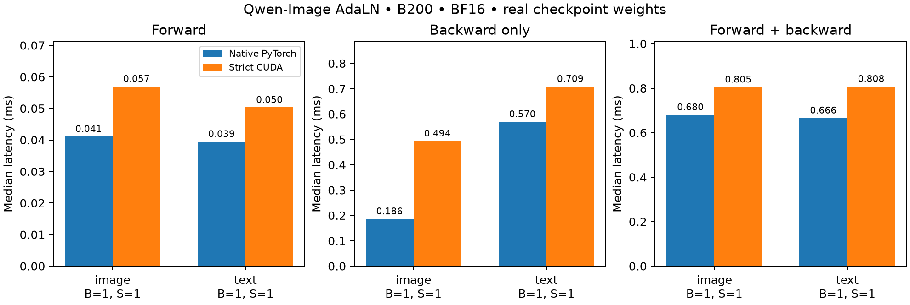
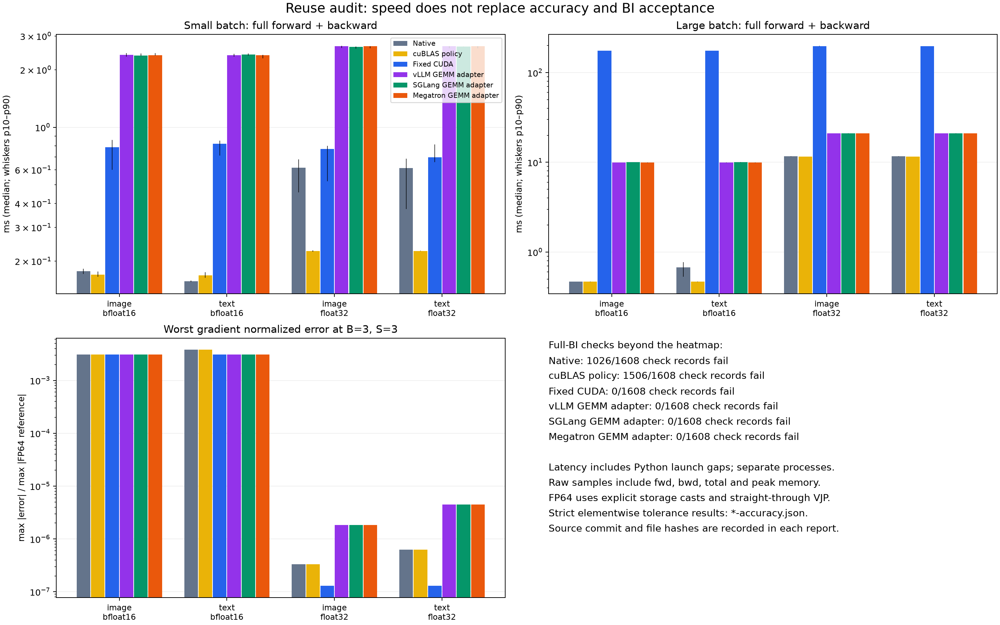
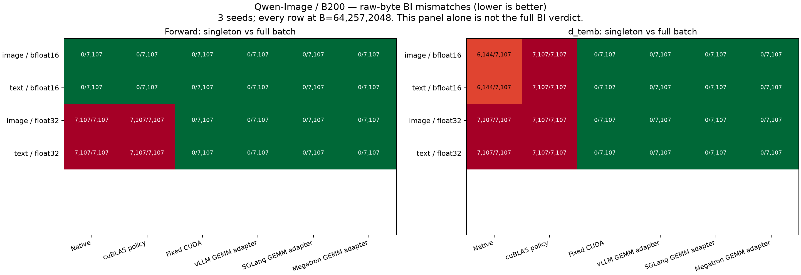
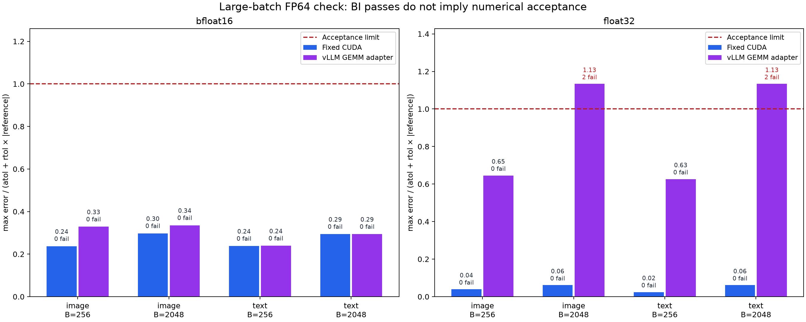

# Qwen-Image AdaLN modulation projection — B200 evidence

Evidence for `qwenimage_adaln_mod_projection`. Everything outside
[`historical/`](historical/) was produced from a clean checkout of commit
`893642643f4095451987c326a1449524d3c15496` (source tree
`a51fe6a3d00813667650dc1b74ab1dcacac349cd`) with one extension build (SHA256
`fe366383d6f8…`). Each report records the commit, `clean_commit: true`,
per-file hashes of the Qwen-Image sources and the extension hash; the validator
rejects reports from different commits or builds.

## 1. Operator results

[fixed/acceptance.json](fixed/acceptance.json) is **qualified, with zero failures**:

| Gate | Result |
|---|---:|
| Real-weight accuracy, image/text block-0 weights, seeds 0/127/2026, BF16/FP32, B=1/3/256/2048 | 48/48 |
| Batch-invariance check records (raw bytes, signed zero included) | 1608/1608 |
| Full 4096-sample workload in chunks 7/64/257/1024/2048 | 60/60 |
| Shared-parameter repeat and ordered zero-padding (B=1/255/256/257/2048) | 84/84 |
| Parameter-gradient cancellation screen (B=255/256/257/2048) | 8/8 |
| Qwen-Image, registry/gtest, tolerance, build and layout tests | [101 passed](tests.txt), no skips |

- Every output and gradient (`temb`, `weight`, `bias`) is checked against
  independent CPU FP32 and FP64 references at the unchanged repository
  `reduction` tolerances.
- Batch invariance compares a singleton run with every row of B=64/257/2048,
  plus dense and power-of-two-boundary batch sweeps, row position and reversal.
- The regression run used two GPUs, so device-isolation tests executed.

No tolerance was relaxed. There is no TF32, fast-math, atomics, FP64
arithmetic in CUDA, or change to global math settings.

### Unfused cost versus native PyTorch (BF16, B=1)

Strict operator / native `SiLU + F.linear`, median ms; peak is the allocator
increment above live inputs (MiB). 3 warmups and 10 alternating samples.
Sub-millisecond intervals include host launch gaps and vary between runs.

| Stream | Forward | Backward | Forward + backward | Peak MiB |
|---|---:|---:|---:|---:|
| image | 0.057 / 0.041 | 0.494 / 0.186 | 0.805 / 0.680 | 111.6 / 108.1 |
| text | 0.050 / 0.039 | 0.709 / 0.570 | 0.808 / 0.666 | 111.6 / 108.1 |



Raw data: [report.json](report.json); forward-only screen including native BF16
and FP32: [prior-art.json](prior-art.json).

## 2. Reuse survey

Each candidate implements `SiLU + Linear` on the full forward and backward path.
The batch-invariant persistent GEMMs are forward-only, so they share one audit
adapter that supplies an FP32 VJP using the same GEMM. Raw reports are in
[audit/](audit/); per-row counts are in [bi-summary.csv](audit/bi-summary.csv).

| Candidate | Failed BI records / 1608 | Singleton d_temb rows | Accuracy failures (unchanged tolerances) |
|---|---:|---:|---|
| PyTorch `SiLU + F.linear` | 1026 | 26502 / 28428 | not measured (batch-variant) |
| PyTorch with cuBLAS workspace policy | 1506 | 28428 / 28428 | not measured (batch-variant) |
| vLLM persistent GEMM (vendored in `benchmarks/layers`) | 0 | 0 / 28428 | FP32 B=2048 `d_weight`: 2 elements per stream |
| SGLang 0.5.21 persistent GEMM | 0 | 0 / 28428 | FP32 B=2048 `d_weight`: 2 elements per stream |
| Megatron-LM `52fbcbc` persistent GEMM | 0 | 0 / 28428 | FP32 B=2048 `d_weight`: 2 elements per stream |
| **Fixed Qwen-Image CUDA** | **0** | **0 / 28428** | **none** |

All three persistent GEMMs pass every BF16 case and every FP32 case up to
B=256. Their only failure is FP32 `d_weight` at B=2048, where 2 elements per
stream exceed the FP32 tolerance (atol = rtol = 1e-4). The three give identical
results; SGLang's and Megatron's kernels state that they are adapted from
Thinking Machines' `batch_invariant_ops`.

Image stream, full forward + backward median ms (text is similar; see `audit/*-reuse.json`):

| Candidate | BF16 B=1 | BF16 B=2048 | FP32 B=1 | FP32 B=2048 |
|---|---:|---:|---:|---:|
| PyTorch | 0.177 | 0.468 | 0.615 | 11.640 |
| PyTorch + cuBLAS policy | 0.170 | 0.468 | 0.226 | 11.585 |
| vLLM / SGLang / Megatron GEMM | 2.391 / 2.371 / 2.383 | 9.942 / 10.048 / 9.937 | 2.652 / 2.633 / 2.647 | 21.041 / 21.011 / 21.036 |
| Fixed CUDA | 0.787 | 175.342 | 0.772 | 197.924 |

At B=1–3 the fixed kernel is 2.6–3.4× faster than the batch-invariant GEMMs;
at B=256 and above it is 6–18× slower. Its parameter gradients walk the batch
in one ascending compensated sum per output element, which keeps each element's
reduction order independent of B but serializes over the batch.





Libraries with no applicable implementation, checked by source:

- FlashAttention `94e22c9`: `flash_attn/ops/fused_dense.py` (`FusedDense`,
  `FusedMLP`) runs linear layers through the cuBLASLt `fused_dense_lib`
  extension with GELU/ReLU epilogues; it has no SiLU and no batch-invariance
  contract, so it falls in the same class as the PyTorch rows above.
- FlashInfer `34bb66e`: no batch-invariant linear; its DiT LayerNorm kernels
  (`flashinfer/norm/__init__.py`) cover modulation, not this projection, and are
  forward-only.
- CUTLASS `0b55a2f`: GEMM templates and examples only; no `SiLU + Linear`
  operator with a batch-invariance contract or autograd.
- verl `1d367a4`, Miles `05bd9cb`, Vime `b9ecdf5`:
  `git grep -iE 'img_mod|txt_mod|AdaLayerNormContinuous|adaln'` finds no AdaLN
  operator. They use vLLM/SGLang for rollout and Megatron/FSDP for training;
  those batch-invariant GEMMs are measured above.

## 3. Historical results (not reproducible from this commit)

These measured code that has since been removed. They were taken on B200 before
the repository layout refactor; their commits are not part of this branch.

- **Parameter-gradient precision repair.** The original ascending FP32 FMA
  `d_weight` reduction exceeded the FP32 tolerance at B=2048 (2 elements per
  projection stream, max error/tolerance 1.133). The Neumaier reducer validated
  in section 1 brought this to 0 violations (ratio 0.061).
  [CSV](historical/precision-repair/precision.csv),
  [figure](historical/precision-repair/precision.png).
- **K=32 partial-dot reducer.** 38.5%–50.6% faster than the fixed reducer at
  B=256/2048, but rejected: cancellation screen 1/8, and 36 of 36
  B=255→256/257 dispatch comparisons changed bytes
  ([acceptance](historical/k32-reducer/acceptance.json),
  [rejection data](historical/k32-reducer/candidate-rejection.csv),
  [timing](historical/k32-reducer/performance-summary.csv)).
- **Ordered-tile Neumaier reducer.** Passed every numerical gate, but was
  16.8%–25.5% slower than the fixed reducer at B=256/2048, failing the ≥10%
  speedup gate ([gates](historical/ordered-tile-reducer/selection-gates.json),
  [timing](historical/ordered-tile-reducer/performance-summary.csv)).

## Pins and environment

- Checkpoint `Qwen/Qwen-Image@75e0b4be04f60ec59a75f475837eced720f823b6`
  (`transformer_blocks.0.img_mod.1`, `transformer_blocks.0.txt_mod.1`; SHA256
  values in `report.json`); Diffusers `d961a388fd02e4db38d17350c8dd9b8abe642e05`.
- PyTorch 2.13.0+cu130, CUDA 13.0, driver 580.126.20, B200 (SM100); TF32 off.
- SGLang 0.5.21 installed into a separate `--target` directory on
  `PYTHONPATH`; Megatron-LM is loaded from a source checkout
  (`--megatron-src`), and reports record its commit.

## Reproduction

From a clean checkout, writing outputs outside the tree:

```bash
export PYTHONPATH=. MODEL=<path-to-Qwen-Image> OUT=<output-dir>
KERNEL_ALIGN_USE_FAST_MATH=0 TORCH_CUDA_ARCH_LIST=10.0 python setup.py build_ext --inplace
python -m pytest tests/models/qwenimage tests/runtime/test_kernel_registry.py \
  tests/contracts/test_tolerance_contract.py tests/build/test_build_platform_collectives.py \
  tests/validation/operators/test_ws1_gtest_gpu.py tests/runtime/test_layout_compatibility.py -q
python benchmarks/models/qwenimage/adaln_evidence.py --model "$MODEL" --output "$OUT/report.json" --repeats 10
python benchmarks/models/qwenimage/adaln_prior_art.py --model "$MODEL" --output "$OUT/prior-art.json"
for seed in 0 127 2026; do for phase in accuracy accuracy_large; do
  python benchmarks/models/qwenimage/adaln_reuse_bi_audit.py --mode fixed \
    --phase "$phase" --seed "$seed" --model "$MODEL" --output "$OUT/fixed/$phase-$seed.json"
done; done
for phase in bi workload parameters; do
  python benchmarks/models/qwenimage/adaln_reuse_bi_audit.py --mode fixed \
    --phase "$phase" --model "$MODEL" --output "$OUT/fixed/$phase-0.json"
done
python benchmarks/models/qwenimage/adaln_parameter_screen.py --output "$OUT/fixed/cancellation-screen.json"
python benchmarks/models/qwenimage/validate_adaln_repair.py "$OUT/fixed"
# Reuse survey; modes: native cublas_policy fixed vllm_local sglang_local megatron_local;
# phases: reuse bi workload accuracy accuracy_large
python benchmarks/models/qwenimage/adaln_reuse_bi_audit.py --mode <mode> --phase <phase> \
  --model "$MODEL" --megatron-src <Megatron-LM> --output "$OUT/audit/<mode>-<phase>.json"
# Plots (needs matplotlib):
python benchmarks/models/qwenimage/plot_adaln_evidence.py "$OUT/report.json" "$OUT/figure.png"
python benchmarks/models/qwenimage/plot_adaln_audit.py "$OUT/audit"
```

Raw per-row BI dumps (about 0.6 MB per run) are not checked in; their totals
are in `fixed/acceptance.json` and `audit/bi-summary.csv`.

## Scope

Isolated Phase A operator with first-order autograd, single-GPU CUDA on B200.
Block-0 projection weights of both streams are covered, not all 60 blocks.
Other architectures, ROCm, full-model, LoRA and distributed execution are not
claimed.
