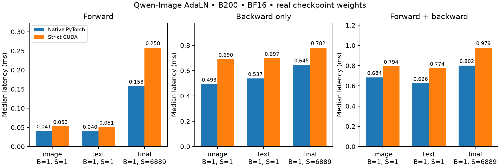
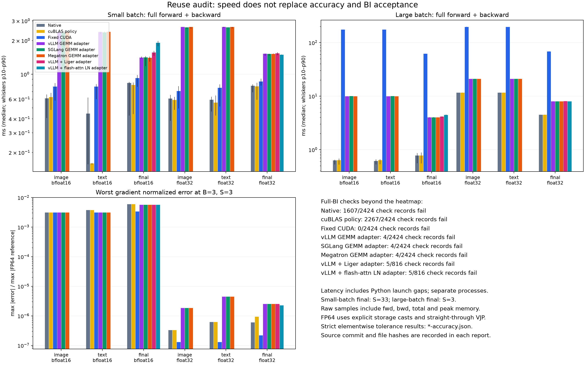
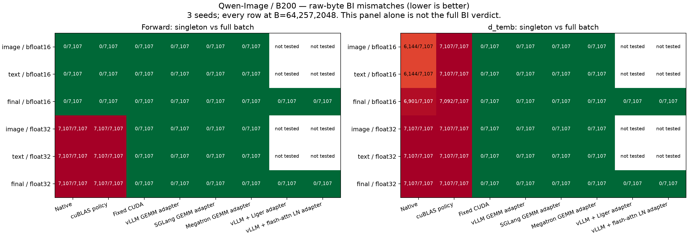
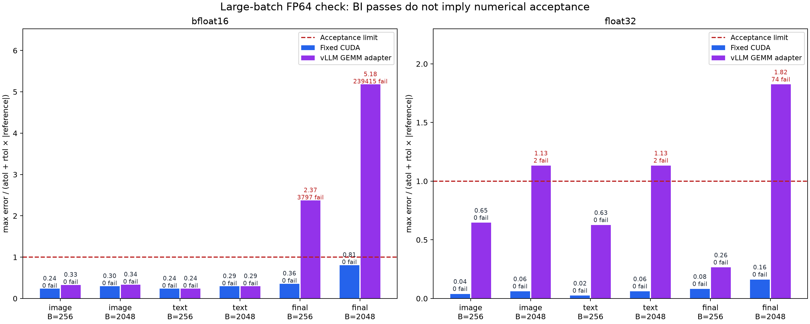

# Qwen-Image final AdaLN output — B200 evidence

Evidence for `qwenimage_final_adaln_out`. Every file here was produced from a
clean checkout of commit `55f83d2b9043f41dca84440d9002ca30f5d3fac4` (source tree
`911345cfc841f7bf86a66e66e72a39d9d80acbf3`) with one extension build (SHA256
`5d1054db8bba…`). Each report records the commit, `clean_commit: true`,
per-file hashes of the Qwen-Image sources and the extension hash; the validator
rejects reports from different commits or builds.

The runners at this commit cover all three conditioning streams, so the
projection streams (image/text, from `adaln_mod_projection`) are included and
re-validated here. The projection's reuse decision is documented in
[its evidence](../qwenimage-adaln-mod-projection-b200/README.md); this page
focuses on the final stream.

## 1. Operator results

[fixed/acceptance.json](fixed/acceptance.json) is **qualified, with zero failures**:

| Gate | All streams | Final stream |
|---|---:|---:|
| Real-weight accuracy, seeds 0/127/2026, BF16/FP32 | 90/90 | 42/42 |
| Batch-invariance check records (raw bytes, signed zero included) | 2424/2424 | 816/816 |
| Full 4096-sample workload in chunks 7/64/257/1024/2048 | 90/90 | 30/30 |
| Shared-parameter repeat and ordered zero-padding (B=1/255/256/257/2048) | 126/126 | 42/42 |
| Parameter-gradient cancellation screen | 8/8 | — |
| Qwen-Image, registry/gtest, tolerance, build and layout tests | [135 passed](tests.txt), no skips | |

- Final accuracy covers B=1/3 at S=3, B=1 at S=4096/6889/6032, and B=256/2048
  at S=3. Every output and gradient (`x`, `temb`, `weight`, `bias`) is checked
  against independent CPU FP32 and FP64 references at the unchanged repository
  `reduction` tolerances.
- [report.json](report.json) adds an FP64 diagnostic for FP32 final cases: both
  the CUDA gradients and the CPU FP32 reference pass against FP64 (4/4).
- Batch invariance compares a singleton with every row of B=64/257/2048, dense
  and power-of-two-boundary batch sweeps, row position and reversal, and B=2
  versus B=1 at S=31/32/33/4096/6889/6032.
- The CPU reference sums tokens with sequential Neumaier summation; a 128-token
  blocked sum previously lost small contributions under cancellation
  (`tests/models/qwenimage/test_reference.py::test_fp32_reference_retains_small_token_contributions`).
- The regression run used two GPUs, so device-isolation tests executed.

### Unfused cost versus native PyTorch (BF16, B=1)

Strict operator / native PyTorch composition, median ms; peak is the allocator
increment above live inputs (MiB). 3 warmups and 10 alternating samples.
Sub-millisecond intervals include host launch gaps and vary between runs.

| Workload | Forward | Backward | Forward + backward | Peak MiB |
|---|---:|---:|---:|---:|
| final, S=6889 | 0.258 / 0.158 | 0.782 / 0.645 | 0.979 / 0.802 | 605.5 / 350.4 |



The operator keeps FP32 normalization state and explicit intermediates, so it
uses more memory than the native composition. No speedup is claimed.

## 2. Reuse survey (final stream)

Each candidate composes an existing batch-invariant projection with an existing
LayerNorm; modulation uses native autograd. Raw reports are in [audit/](audit/);
per-row BI counts are in [bi-summary.csv](audit/bi-summary.csv).

| Candidate | Failed BI records / 816 | Singleton d_temb rows | BF16 d_weight violations, S=6889 | FP32 B=2048 d_weight violations |
|---|---:|---:|---:|---:|
| PyTorch `F.linear` + `F.layer_norm` | 581 | 14008 / 14214 | — | — |
| PyTorch with cuBLAS workspace policy | 761 | 14199 / 14214 | — | — |
| vLLM persistent GEMM + `F.layer_norm` | 4 | 0 / 14214 | 40,442 | 74 |
| SGLang 0.5.21 persistent GEMM + `F.layer_norm` | 4 | 0 / 14214 | 40,442 | 74 |
| Megatron-LM `52fbcbc` persistent GEMM + `F.layer_norm` | 4 | 0 / 14214 | 40,442 | 74 |
| vLLM GEMM + Liger 0.8.4 LayerNorm | 5 | 0 / 14214 | 40,459 | 75 |
| vLLM GEMM + flash-attention `94e22c9` Triton LayerNorm | 5 | 0 / 14214 | 40,442 | 70 |
| **Fixed Qwen-Image CUDA** | **0** | **0 / 14214** | **0** | **0** |

The persistent-GEMM compositions remove the per-row `temb` batch dependence;
every remaining BI failure is a long-sequence record (B=2 versus B=1 at
S=4096/6889/6032). All five compositions also exceed the BF16 tolerance for
`d_weight`/`d_bias` at S=4096/6889/6032 (24,000–40,000 elements) and at
B=256/2048. In these compositions the modulation backward, including its token
sums, runs through native autograd; the fixed operator accumulates those sums in
a fixed FP32 tree. Native and cuBLAS-policy compositions are batch-variant, so
their accuracy was not measured.

Final stream, full forward + backward median ms:

| Candidate | BF16 B=1, S=6889 | BF16 B=2048, S=3 | FP32 B=2048, S=3 |
|---|---:|---:|---:|
| PyTorch | 0.814 | 0.780 | 4.485 |
| vLLM / SGLang / Megatron GEMM | 1.481 / 1.475 / 1.487 | 4.003 / 4.030 / 4.004 | 8.013 / 7.984 / 8.008 |
| vLLM GEMM + Liger / flash-attention LayerNorm | 1.596 / 1.908 | 4.167 / 4.451 | 8.063 / 8.018 |
| Fixed CUDA | 0.968 | 61.918 | 68.591 |

At B=1 the fixed operator is slower than native PyTorch but faster than every
reuse candidate; at large conditioning batches it is the slowest. No reuse
candidate passes accuracy.





Libraries with no applicable implementation, checked by source:

- FlashInfer `34bb66e`: `flashinfer/norm/__init__.py`
  `fused_dit_residual_layernorm_scale_shift` (and the gated variants) fuse
  LayerNorm with scale/shift, but are BF16 forward-only with no backward, so
  they cannot serve training.
- CUTLASS `0b55a2f`, verl `1d367a4`, Miles `05bd9cb`, Vime `b9ecdf5`:
  `git grep -iE 'img_mod|txt_mod|AdaLayerNormContinuous|adaln'` finds no AdaLN or
  modulation operator. verl, Miles and Vime use vLLM/SGLang for rollout and
  Megatron/FSDP for training; those paths are measured above.

## Pins and environment

- Checkpoint `Qwen/Qwen-Image@75e0b4be04f60ec59a75f475837eced720f823b6`
  (`norm_out.linear` and both block-0 modulation tensors; SHA256 values in
  `report.json`); Diffusers `d961a388fd02e4db38d17350c8dd9b8abe642e05`.
- PyTorch 2.13.0+cu130, CUDA 13.0, driver 580.126.20, B200 (SM100); TF32 off.
- SGLang 0.5.21 and Liger 0.8.4 installed into a separate `--target`
  directory on `PYTHONPATH`. Megatron-LM and flash-attention are loaded from
  source checkouts (`--megatron-src`, `--flash-attn-src`); reports record their
  commits.

## Reproduction

From a clean checkout, writing outputs outside the tree:

```bash
export PYTHONPATH=. MODEL=<path-to-Qwen-Image> OUT=<output-dir>
KERNEL_ALIGN_USE_FAST_MATH=0 TORCH_CUDA_ARCH_LIST=10.0 python setup.py build_ext --inplace
python -m pytest tests/models/qwenimage tests/runtime/test_kernel_registry.py \
  tests/contracts/test_tolerance_contract.py tests/build/test_build_platform_collectives.py \
  tests/validation/operators/test_ws1_gtest_gpu.py tests/runtime/test_layout_compatibility.py -q
python benchmarks/models/qwenimage/adaln_evidence.py --model "$MODEL" \
  --output "$OUT/report.json" --repeats 10 --fp64-check
python benchmarks/models/qwenimage/adaln_prior_art.py --model "$MODEL" --output "$OUT/prior-art.json"
for seed in 0 127 2026; do for phase in accuracy accuracy_large; do
  python benchmarks/models/qwenimage/adaln_reuse_bi_audit.py --mode fixed \
    --phase "$phase" --seed "$seed" --model "$MODEL" --output "$OUT/fixed/$phase-$seed.json"
done; done
for phase in bi workload parameters; do
  python benchmarks/models/qwenimage/adaln_reuse_bi_audit.py --mode fixed \
    --phase "$phase" --model "$MODEL" --output "$OUT/fixed/$phase-0.json"
done
python benchmarks/models/qwenimage/adaln_parameter_screen.py --output "$OUT/fixed/cancellation-screen.json"
python benchmarks/models/qwenimage/validate_adaln_repair.py "$OUT/fixed"
# Reuse survey; modes: native cublas_policy fixed vllm_local sglang_local megatron_local
# vllm_liger vllm_flashattn; phases: reuse bi workload accuracy accuracy_large
python benchmarks/models/qwenimage/adaln_reuse_bi_audit.py --mode <mode> --phase <phase> \
  --model "$MODEL" --megatron-src <Megatron-LM> --flash-attn-src <flash-attention> \
  --output "$OUT/audit/<mode>-<phase>.json"
# Plots (needs matplotlib):
python benchmarks/models/qwenimage/plot_adaln_evidence.py "$OUT/report.json" "$OUT/figure.png"
python benchmarks/models/qwenimage/plot_adaln_audit.py "$OUT/audit"
```

Raw per-row BI dumps (about 0.6 MB per run) are not checked in; their totals
are in `fixed/acceptance.json` and `audit/bi-summary.csv`.

## Scope

Isolated Phase A operator with first-order autograd, single-GPU CUDA on B200.
It covers `norm_out` only; the later 3072→64 `proj_out` belongs to
`latent_proj_gemm`. Long token lengths and large batches are covered
separately, not every B×S combination. No full-model, LoRA, distributed,
other-architecture or ROCm claim is made.
