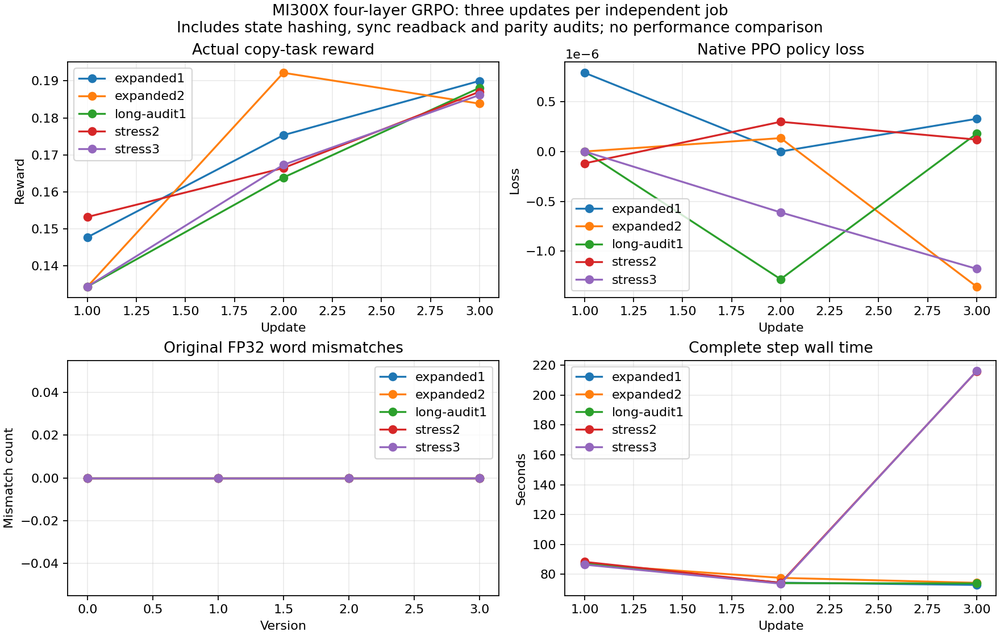

# Native verl GRPO on four MI300X GPUs

For AMD reproduction, artifact prerequisites, multi-node communication preparation
and the remaining model-integration gates, see the
[AMD handoff guide](../../../../../docs/usage/dsv4-rocm-amd-handoff.md).
The guide does not extend the measured scope of this report.

**Work in progress: the historical `final-run1` version-3 failure and two standalone final-image GPU test setup errors remain unresolved.** The completed jobs below executed three continuous real updates and passed every requested comparison in those jobs. They do not explain or erase the earlier failure. This is not a declaration that all four-layer acceptance work is complete.

The tables below list qualified completed jobs; the preserved failed and incomplete jobs are explicitly reported under limitations. They are not silently included as passes.

The scope is one node and four original checkpoint layers, with actor physical GPUs 4,5 and rollout 6,7, both TP1/PP2/EP1/CP1/DP1. Original layers are partitioned 0–2 / 3. Only `rocm_triton / split`, eager execution and this topology were tested this round. There is no DP gradient reduction, full-model, multi-node, performance improvement or learning-benefit claim. Older DP2 and two-backend evidence in this PR remains separate.

## Real training path and changes

The entry is `python -m verl.experimental.rl_kernel.main_ppo`: normal community verl data loading and AgentLoop, actual vLLM generation, a real copy-task rule reward, native GRPO advantages, native `verl.workers.utils.losses.ppo_loss`, native Megatron pipeline backward and optimizer, and online synchronization to the same vLLM processes. `train_batch_size=ppo_mini_batch_size=2` counts prompts; `n=2` gives four completions and one optimizer update per global step. Optimizer objects and moments persist for all three steps. No diagnostic negative-mean-logprob loss substitutes for PPO.

RLK fixes the original layer-2 compressor projection boundary: NVIDIA uses separate main/indexer projections, whereas AMD vLLM fuses them. Original BF16 operands accumulate into FP32 with one fixed reduction profile and a real VJP. The original captured native split/fused outputs differ; the regression uses the original checkpoint and the failing input. Canonical backward now accepts the declared overlapping native PP1F1B uses and reduces only after all contributions arrive. New evidence retains updated policies, records original raw FP32 scores and real backward hooks, and rejects missing rows, NaN/Inf, stale versions and corrupted evidence. Expanded failure traces include actual sparse-attention KV/indices and pre-shuffled GEMM boundaries. No speculative FP8 numerical patch was added from an unrelated dispatch probe.

The companion [verl PR #1](https://github.com/RL-Align/verl/pull/1) supplies the formal entry, worker startup compatibility, actual raw-logprob/PPO wiring and persistent worker sync/audits. No upstream Megatron, Bridge, vLLM or AITER source was modified. Existing Megatron-Lite integration and strict PP2/DP2 checks remain intact.

## Per-version evidence

| Run | Version / updates | Expected | Compared | Mismatches | B1/B2/repeat and sync |
|---|---:|---:|---:|---:|---|
| expanded1 | 0 / 0 | 1252 | 1252 | 0 | PASS |
| expanded1 | 1 / 1 | 1252 | 1252 | 0 | PASS |
| expanded1 | 2 / 2 | 1252 | 1252 | 0 | PASS |
| expanded1 | 3 / 3 | 1188 | 1188 | 0 | PASS |
| expanded2 | 0 / 0 | 1252 | 1252 | 0 | PASS |
| expanded2 | 1 / 1 | 1252 | 1252 | 0 | PASS |
| expanded2 | 2 / 2 | 1252 | 1252 | 0 | PASS |
| expanded2 | 3 / 3 | 1188 | 1188 | 0 | PASS |
| long-audit1 | 0 / 0 | 1252 | 1252 | 0 | PASS |
| long-audit1 | 1 / 1 | 1252 | 1252 | 0 | PASS |
| long-audit1 | 2 / 2 | 1252 | 1252 | 0 | PASS |
| long-audit1 | 3 / 3 | 1188 | 1188 | 0 | PASS |
| stress2 | 0 / 0 | 1252 | 1252 | 0 | PASS |
| stress2 | 1 / 1 | 1252 | 1252 | 0 | PASS |
| stress2 | 2 / 2 | 1252 | 1252 | 0 | PASS |
| stress2 | 3 / 3 | 1188 | 1188 | 0 | PASS |
| stress3 | 0 / 0 | 1252 | 1252 | 0 | PASS |
| stress3 | 1 / 1 | 1252 | 1252 | 0 | PASS |
| stress3 | 2 / 2 | 1252 | 1252 | 0 | PASS |
| stress3 | 3 / 3 | 1188 | 1188 | 0 | PASS |

Counts are finite original FP32 token observations, including explicit repeated engine-invariance comparisons. `consistency.csv` splits cross-engine observations from invariance observations. Each version has 1,188 observations in the fixed/fresh A/B/C matrix. Versions 0–2 additionally have 64 tokens from the actual native PPO training batch, so their report total is 1,252; version 3 has 1,188. Every comparison checks original FP32 bits, `expected_tokens == compared_tokens > 0`, zero mismatches and zero mean/max absolute difference. No allclose, low-precision cast or invalid-token removal is used.

The original fixed sequences (prompt lengths 159/45/5, response length 3) remain unchanged across versions. Fresh responses are generated at each version (up to 16 tokens), including after the third update. The extended fresh A prompt is 213 tokens; fresh B and C are 45/5. Fresh AB packs 290 rows and crosses the 256-row boundary. Real scheduler/forward metadata proves B2 for AB, BA, AC and CA, repeated orders and position changes; two B1 requests are not accepted as B2. The original masks, positions, causal shift, boundaries and full response token lengths are independently checked.

| Run | v3 real requests | Expected | Compared | Mismatches | Actor/rollout state and PID |
|---|---:|---:|---:|---:|---|
| stress2 | 1000 | 14869 | 14869 | 0 | PASS |
| stress3 | 1000 | 14869 | 14869 | 0 | PASS |

The optional v3 stress phase performs no additional optimizer updates. It uses actual actor baselines from that same version, repeatedly scores real B1/B2 requests on the original rollout PIDs, saves every raw comparison, then re-exports actor state and reads every rollout shard back without loading a replacement. The independent verifier checks these raw files and final unchanged-state receipts.

## Updates and synchronization

`training.csv` gives actual per-step reward, advantage range/nonzero count, native PPO loss, changed parameter counts, effective gradient coverage and optimizer clocks. `worker-identities.json` contains the actual parameter inventory and model class/source. NVIDIA's real `HybridModel` expands each original attention/MoE layer into its native hybrid modules; this does not add original checkpoint layers.

Original packed FP4 expert weights, FP8 weights and all quantization scales remain frozen and retain their checkpoint precision. There are 83 nonquantized trainable parameters: 58 on actor PP rank 0 and 25 on rank 1, totaling 1,081,524,829 elements (50 FP32 tensors and 33 BF16 tensors). All 83 have finite real autograd-hook evidence; short training inputs activate nonzero gradients on 74. Inactive indexer/long-compressor branches and BF16 update rounding mean not every tensor changes at every step. This is not full quantized-base training or full long-context branch coverage.

Each step records four real PP forward activation transfers and four backward gradient transfers, with sender/receiver hashes and finite, effective gradients. Native optimizer clocks/moments, before/after parameter hashes and actual changes are checked. The dynamic original-tensor manifest, shard ownership, load/readback hashes and versions are verified on the same rollout worker PIDs. Router bias is included where it actually exists. The original integer routing map's I64-to-runtime-I32 ABI conversion must round-trip losslessly; floating weights/scales and raw logprobs are not converted to create a pass. There is no fixed tensor-count success criterion. Sync closes admissions, invalidates the required caches, reads loaded shards back, then publishes/resumes the new version.

## Timing and metrics

`timing.csv` separates actual AgentLoop generation/reward RPCs, GRPO advantage, actor logprob, native backward/optimizer plus evidence hashing, weight synchronization/readback, independent audits and the complete step. Reward RPC intervals can overlap; they are not additive stages. Complete step times include audits and, when enabled, the final v3 stress phase. Token/GPU/s uses response tokens divided by two rollout GPUs or four total job GPUs, explicitly named in the CSV. These heavily instrumented measurements are not a performance comparison. Three functional updates do not establish training benefit.

## Preserved failure and limitations

`failures.csv` includes the failed comparison without filtering any of its three valid tokens. `historical-failure.json` preserves the earlier `final-run1` v3 fixed AB A failure: all three valid response scores differ, although actor B1/B2 and rollout B1 agree. First target token 128819 is at absolute position 159 (predicting row 158); actor bits are `0xbc762800`, rollout bits `0xbc740800`. The original failing updated weights were removed by the old transfer-file lifecycle, and no internal failure trace was captured then. The first differing internal module is therefore **unknown**. Current code retains each updated policy and captures boundaries immediately on any recurrence.

Replaying the original PPO inputs reproduces all four PP forward activation hashes and the native PPO loss but not the independent backward trajectory or original updated weights. `failed-policy-replay-comparison.json` records this limitation. Independent training trajectories are not reproducible, even when same-run/same-version actor–rollout parity passes; these are separate claims.

The initial `stress1` captured 1,000 requests / 14,869 token observations with zero differences, but lacks a final process exit record and is **not** counted as completed acceptance. The strict full-job verifier correctly rejects it. An earlier final-image compressor test invocation also failed at the original captured input host-to-device copy (`hipErrorInvalidValue`). This remains unresolved in the standalone final-image regression: two setup errors, not two passing GPU tests. Both device-isolation and bootstrap variants are preserved in the logs. A prior development-image GPU invocation passed these two cases; it does not replace final-image verification. `fp8-probe-scope.json` separates exploratory ordinary GEMM probes from the actual AMD pre-shuffled dispatch; none is claimed to resolve the historical failure.

## Versions, artifacts and reproduction

`sources.lock` records the full four measured source SHAs, URLs, import paths, versions and dirty states from the actual container. `worker-identities.json` repeats this for driver/actor processes; rollout/mp process identities are also in each original `driver.log`. `image.json` records the exact image/base IDs and source SHAs. Tested source hashes are in `tested-source-hashes.json`; subsequent report-only publication does not change these execution files. Bridge 0.7.0, Torch 2.13.0+rocm10.0.0, Torch HIP 7.15.26333, ROCm SDK 10.0.0, Triton 3.8.0+git669b31ac, AITER 0.1.29 and TransferQueue 0.1.11 are preserved. Runtime RCCL logs identify HIP 7.16.26361; this is distinguished from Torch's build HIP version. AITER remains enabled for normal dependencies; mHC uses RLK.

Checkpoint SHA256: `1bd423ab1d98f43d40b19617fcb30d973d94436cc7b150fe3f744de79c2de086`, 16,416,050,412 bytes, original source revision `60d8d70770c6776ff598c94bb586a859a38244f1`, original layers 0–3. `checkpoint-inventory.json` records dtype counts and original sync state; `data-manifest.json` records the deterministic six task examples and parquet checksums. `hydra-config.yaml` is the resolved actual configuration. No source directory is mounted into training containers. Only models, data, outputs and private cache are mounted.

Physical mappings: GPU4 PCI `0000:a3:00.0` / KFD36258 / renderD161; GPU5 `0000:ab:00.0` / KFD19365 / renderD169; GPU6 `0000:b3:00.0` / KFD16815 / renderD177; GPU7 `0000:bb:00.0` / KFD34728 / renderD185. The isolated container's four devices are logical 0–3. Actor Ray assignments 0/1 correspond to physical 4/5; rollout 2/3 and PP process 0/1 correspond to physical 6/7. Actual PID and PCI mappings are saved per run. No compute was launched on physical GPUs 0–3.

`test-results.json` lists 37 passing final-image CPU cases and two final-image original-checkpoint GPU setup errors, with zero skips. The GPU errors are a second outstanding limitation. `logs-index.json` provides paths, byte sizes and SHA256 digests for the actual run evidence, including failure records. Large artifacts remain on `/scratch/rl-kernel/vensen/`, not in git. Some completed old policy snapshots are losslessly compressed with decompressed-SHA checks; `artifacts/lossless-policy-archives.jsonl` records exact restoration commands. Current checkpoint and shared caches are untouched.

Run [reproduce.sh](reproduce.sh) on this machine after confirming GPUs 4–7 and quota are available. Every run gets a new container/output directory and retains workers/optimizer throughout its three updates. The script uses the formal verl entry through the committed launcher, then the independent strict verifier. Full build context and git bundles are in `build/stress-code` under the run root. No PR is merged automatically.
