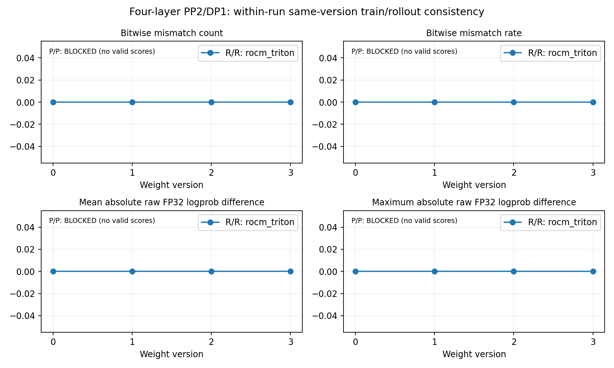
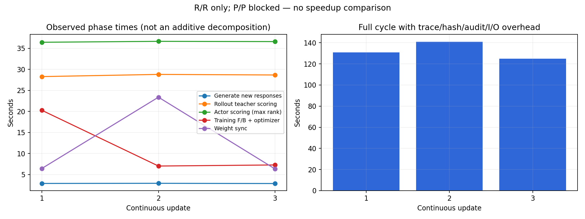
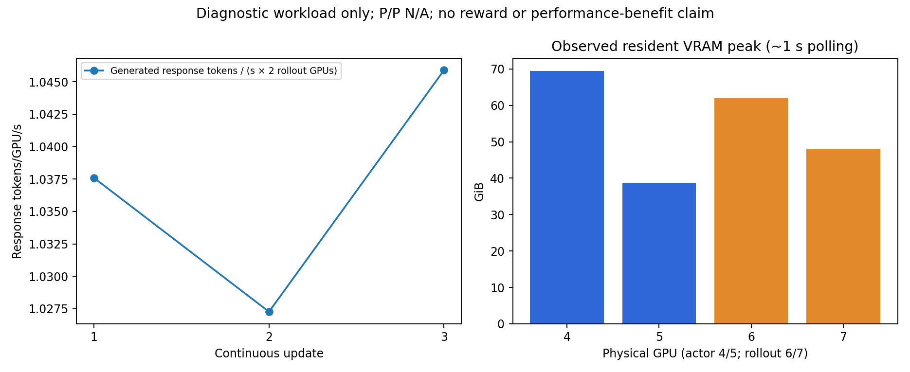

# Native verl versus verl + RL-Kernel: DSV4 four-layer PP2/DP1


This report follows the evidence layout of [PR #377](https://github.com/RL-Align/RL-Kernel/pull/377). It uses this machine’s actual four-layer results; no Qwen/H100, 200-step, reward or bootstrap results are reused.


## 1. Completed experiment scope


| Group | Actual route | Job / container | Completed updates | Status |
| --- | --- | --- | --- | --- |
| P/P | Pristine verl Megatron TrainingWorker + pristine verl vLLM PP2 configuration | native-PP-20261117T110114Z / ecd7bf7c39c0 | 0 | BLOCKED |
| R/R | Real verl RLK native-MCore actor + RLK verl/vLLM workers; rocm_triton, split | rlk-RR-rocm_triton-20261117T110351Z / 440e7f527ff0 | 3 | PASSED |


The two fresh containers ran sequentially, on the same physical GPUs. P/P is **BLOCKED**, not inconsistent or zero-throughput. Both actor ranks failed before loading the model. Native verl also rejected PP2 rollout.


- `actor`, rank `0`: `ModuleNotFoundError: No module named 'megatron.core.dist_checkpointing.strategies.async_utils'`; RLK modules loaded: `[]`.

- `actor`, rank `1`: `ModuleNotFoundError: No module named 'megatron.core.dist_checkpointing.strategies.async_utils'`; RLK modules loaded: `[]`.

- `rollout`, rank `None`: `NotImplementedError: Current rollout self.name='vllm' not implemented pipeline_model_parallel_size > 1 yet.`; RLK modules loaded: `[]`.


The separate **direct native vLLM** capability check exited 0. It loaded the original checkpoint, selected `TRITON_UNFUSED Mxfp4` on gfx942 and generated outputs. This establishes a native vLLM capability, **not** completion of the native verl actor/rollout experiment. We do not claim original FP4 inference is unsupported. Exact call stacks and logs are indexed in `raw-log-index.json`.


## 2. Matched workload


The following conditions were executed by R/R and requested for P/P; the native import/configuration blockers prevented verification of a matched native training objective. No speed comparison between matched completed training jobs is possible.


| Item | Condition |
| --- | --- |
| Hardware | One AMD MI300X node; actor physical 4,5; rollout 6,7; GPUs 0–3 excluded |
| Parallelism | Actor TP1/PP2/EP1/CP1/DP1; rollout TP1/PP2/EP1/CP1/DP1 |
| PP partition | Original layers [0,1,2] / [3], not 2+2 |
| Checkpoint | /scratch/rl-kernel/vensen/dsv4-4l/models/DeepSeek-V4-Flash-4l |
| Checkpoint SHA256 | 1bd423ab1d98f43d40b19617fcb30d973d94436cc7b150fe3f744de79c2de086 |
| Original revision | 60d8d70770c6776ff598c94bb586a859a38244f1 |
| Precision | Original packed FP4/FP8 weights and original scales frozen; nonquantized BF16/FP32 dtypes retained |
| Seeds | Actor 42; rollout 42; greedy generation |
| Execution | Eager, no dropout; standalone PP2 rollout; no graph capture |
| Fixed inputs | A/B/C full lengths 131/130/10; saved before either job; SHA256 0356c0d7e3db565af9fb4e807a4513194a7980962bcf5465a1fb7ac74e77be95 |
| Matrix | B1 A/B/C; genuine B2 AB/BA; individual and batch repeats, fixed and newly generated sequences |
| Training microbatch | Fixed A, B1, same order for all 3 continuous steps; 129 prompt + 2 response-loss tokens |
| Loss | negative mean response-token raw logprob; global response loss-mask token count |
| Optimizer | Native Adam/FusedAdam; lr=0.0001; betas=[0.9, 0.999]; clip=1.0; weight_decay=0.0; linear LR schedule over 4 configured steps |
| State | Same workers and optimizer/moments through versions 0/1/2/3; clocks 1/2/3 |
| Cache/warmup | Same cache path and image, no cache clearing; pre-existing shared compilation cache; normal engine warmup, no extra performance warmup |
| Resource policy | Same 16 GiB container shm, OMP_NUM_THREADS=4, rollout memory utilization 0.30, max model length 256, max_num_seqs=2 |


The selected trainable group contains 83 native Parameters (1,081,524,829 elements); all have backward entries. In this short-context workload 77 have nonzero gradients: five indexer Parameters and the first mHC alpha_pre scalar have zero gradients. Not every Parameter changes at every step; actual rank/version counts are in `update-scope.json`. Three frozen routing tables use native int32 indices with the original int64 values preserved exactly. No logprob score casting is used.


Verified R/R device identities (native actor startup failed before model execution):


| Role / PP rank | Physical GPU | Container ordinal | Worker HIP ordinal | HIP PCI |
| --- | --- | --- | --- | --- |
| actor / PP0 | 4 | 0 | 0 | 0000:a3:00.0 |
| actor / PP1 | 5 | 1 | 1 | 0000:ab:00.0 |
| rollout / PP0 | 6 | 2 | 0 | 0000:b3:00.0 |
| rollout / PP1 | 7 | 3 | 1 | 0000:bb:00.0 |

## 3. Version provenance


Both groups used the identical image and actual runtime source/dependency versions below; each checkout was clean. Native provenance was collected in a separate metadata process because that audit installs import ABI hooks; those hooks never ran in the native model processes.


| Project | Version | Full SHA | Repository | Actual import path | Dirty |
| --- | --- | --- | --- | --- | --- |
| verl | 0.10.0.dev | 8c94a12d7811030413cd85e2bba6db863e0913c8 | https://github.com/verl-project/verl.git | /opt/dsv4/verl/verl/__init__.py | False |
| vllm | 0.34.0rc1.dev366+gc07d58dc8 | c07d58dc82d75f7d1a947b3264b460384ec3e18d | https://github.com/vllm-project/vllm.git | /opt/dsv4/vllm/vllm/__init__.py | False |
| Megatron-LM | 0.21.0+97b50bd | 97b50bdd936022ef58031c35db6d10581c181be0 | https://github.com/NVIDIA/Megatron-LM.git | /opt/dsv4/Megatron-LM/megatron/core/__init__.py | False |
| RL-Kernel | 0.1.1 | 3779aac8a112118567d341e213a97dea293c36e8 | https://github.com/RL-Align/RL-Kernel.git | /opt/dsv4/RL-Kernel/rl_engine/__init__.py | False |


| Dependency | Actual version |
| --- | --- |
| megatron-bridge | 0.7.0 |
| torch | 2.13.0+rocm10.0.0 |
| triton | 3.8.0+git669b31ac |
| amd-aiter | 0.1.29 |
| HIP | 7.15.26333 |
| ROCm SDK | 10.0.0 |
| GPU architecture | gfx942 |


Image: `rlk/dsv4-4l-rocm:3779aac-comparison-20261117`; ID `sha256:cc58a6f77dd4b350a7a5abfd53b8595f6908412e30b92452f99fa6f36655558e`. Parent image: `rlk/dsv4-4l-rocm:0967c0b`, `sha256:c98ee8aad117509b7757893a1582ab662c91771531024471a1efeabe6e762c1d`. Bridge 0.7.0’s 878 Python RECORD files and upstream source cleanliness were verified.


Compatibility/implementation inventory:


- Both: selected-render-node visibility and an allowlisted KFD-aperture ABI shim. These restrict device access and do not replace model arithmetic.

- P/P: only RLK’s vLLM general plugin was excluded; other discovered general plugins were retained. No RLK numerical operators, custom VJP, loader, import-ABI adapter, PP server override or math correction was enabled.

- R/R: existing #711 import-ABI/Bridge compatibility, original packed checkpoint loading and PP [0–2]/[3] placement; native MCore scheduling; RLK deterministic mHC/norm/projection/attention/router/combine/FP4 input-gradient and raw-logprob paths; dynamic live shard synchronization including router bias.

- R/R batch-order adaptation explicitly preserves the requested ordinary prefill AB/BA order. Observation timers, read-only captures and comparison tools add overhead. No upstream files or site-packages were edited.

- AITER remains installed/enabled for ordinary dependencies; mHC is RLK rocm_triton + split, not rocm_aiter. #662 remains excluded.


## 4. Strict train/rollout consistency


Each row compares one group’s own actor/rollout at its own actual weight version. Cross-group post-update weights are never scored as a train/rollout mismatch. The count includes repeated batch/position observations, not unique sampled token IDs. All R/R comparisons use original finite FP32 words; diagnostic differences do not replace bitwise acceptance.


| Group | Version | Comparison | Compared / expected | Mismatch count / rate | Mean / max abs diff | Batch invariant | Sync |
| --- | --- | --- | --- | --- | --- | --- | --- |
| P/P | 0 | actor_vs_rollout | N/A | N/A | N/A | N/A | not reached |
| P/P | 0 | actor_repeat_or_batch_position | N/A | N/A | N/A | N/A | not reached |
| P/P | 0 | rollout_repeat_or_batch_position | N/A | N/A | N/A | N/A | not reached |
| P/P | 1 | actor_vs_rollout | N/A | N/A | N/A | N/A | not reached |
| P/P | 1 | actor_repeat_or_batch_position | N/A | N/A | N/A | N/A | not reached |
| P/P | 1 | rollout_repeat_or_batch_position | N/A | N/A | N/A | N/A | not reached |
| P/P | 2 | actor_vs_rollout | N/A | N/A | N/A | N/A | not reached |
| P/P | 2 | actor_repeat_or_batch_position | N/A | N/A | N/A | N/A | not reached |
| P/P | 2 | rollout_repeat_or_batch_position | N/A | N/A | N/A | N/A | not reached |
| P/P | 3 | actor_vs_rollout | N/A | N/A | N/A | N/A | not reached |
| P/P | 3 | actor_repeat_or_batch_position | N/A | N/A | N/A | N/A | not reached |
| P/P | 3 | rollout_repeat_or_batch_position | N/A | N/A | N/A | N/A | not reached |
| R/R | 0 | actor_repeat_or_batch_position | 52 / 52 | 0 / 0.000000 | 0 / 0 | True | initial checkpoint |
| R/R | 0 | actor_vs_rollout | 74 / 74 | 0 / 0.000000 | 0 / 0 | True | initial checkpoint |
| R/R | 0 | rollout_repeat_or_batch_position | 52 / 52 | 0 / 0.000000 | 0 / 0 | True | initial checkpoint |
| R/R | 1 | actor_repeat_or_batch_position | 52 / 52 | 0 / 0.000000 | 0 / 0 | True | verified |
| R/R | 1 | actor_vs_rollout | 70 / 70 | 0 / 0.000000 | 0 / 0 | True | verified |
| R/R | 1 | rollout_repeat_or_batch_position | 52 / 52 | 0 / 0.000000 | 0 / 0 | True | verified |
| R/R | 2 | actor_repeat_or_batch_position | 52 / 52 | 0 / 0.000000 | 0 / 0 | True | verified |
| R/R | 2 | actor_vs_rollout | 70 / 70 | 0 / 0.000000 | 0 / 0 | True | verified |
| R/R | 2 | rollout_repeat_or_batch_position | 52 / 52 | 0 / 0.000000 | 0 / 0 | True | verified |
| R/R | 3 | actor_repeat_or_batch_position | 52 / 52 | 0 / 0.000000 | 0 / 0 | True | verified |
| R/R | 3 | actor_vs_rollout | 70 / 70 | 0 / 0.000000 | 0 / 0 | True | verified |
| R/R | 3 | rollout_repeat_or_batch_position | 52 / 52 | 0 / 0.000000 | 0 / 0 | True | verified |


R/R passed 302 strict comparison rows. Fixed inputs match the predeclared JSON exactly. Each updated version passed native PP activation/gradient transfer, gradient coverage/finiteness, actual parameter changes, optimizer continuity and full dynamic shard readback. Observed inventories contain 71 original keys split 49/22 in these runs; this is an observation, not a hardcoded acceptance criterion. Original rollout PIDs are unchanged and caches advance with each verified weight version. DP1 performs no cross-replica DP gradient reduction.


## 5. Preliminary performance


P/P training/rollout consistency performance is **N/A** because no native verl cycle completed. The native container’s elapsed time includes failed starts and a separate direct-vLLM probe; it is not compared with training time. R/R numbers below are **diagnostic acceptance measurements**, not formal end-to-end GRPO/PPO throughput.


| Version | Generate s | Actor logprob s | F/B + optimizer s | Optimizer subset s | Sync s | Full diagnostic window s | Generated response tokens | Response tok/GPU/s |
| --- | --- | --- | --- | --- | --- | --- | --- | --- |
| 0 | 3.901 | 50.425 | N/A | N/A | N/A | 30.658 | 8 | 1.025 |
| 1 | 2.891 | 36.429 | 20.270 | 7.441 | 6.443 | 130.762 | 6 | 1.038 |
| 2 | 2.920 | 36.649 | 7.025 | 1.747 | 23.380 | 141.024 | 6 | 1.027 |
| 3 | 2.868 | 36.588 | 7.283 | 1.875 | 6.334 | 124.962 | 6 | 1.046 |


| Version | Generated prompt/response tokens | Actor scored input/padded tokens | Actor scored response tokens | Rollout teacher input / auxiliary emitted tokens | Actor input tok/GPU/s |
| --- | --- | --- | --- | --- | --- |
| 0 | 394 / 8 | 3705 / 3713 | 74 | 3303 / 29 | 36.737 |
| 1 | 265 / 6 | 3443 / 3451 | 70 | 3172 / 28 | 47.256 |
| 2 | 265 / 6 | 3443 / 3451 | 70 | 3172 / 28 | 46.972 |
| 3 | 265 / 6 | 3443 / 3451 | 70 | 3172 / 28 | 47.051 |


Timing definitions and limits:


- Actor inference, training and optimizer timers synchronize the local GPU before and after the measured real API. For PP aggregate observations use the maximum rank time. Optimizer is a subset of F/B+optimizer, not an additive extra stage.

- Rollout generation/synchronization use completed real API/RPC acknowledgements; teacher scoring drains all actual request outputs. CPU comparison-tool time is recorded separately.

- Version 1–3 full windows contain the update/export, live synchronization, complete fixed and generated matrices, comparisons, state audits and I/O. Version 0’s full window starts after its initial fixed matrix, so it is not a comparable update-cycle window.

- `response tok/GPU/s = actual generated response tokens / (generation seconds × 2 rollout GPUs)`. `actor input tok/GPU/s = unpadded processed input tokens / (maximum PP rank’s cumulative inference seconds × 2 actor GPUs)`. These include repeated diagnostic work, not unique training examples.

- Teacher-scoring requests emit one auxiliary token per sample (`max_tokens=1`); those outputs are recorded separately from the primary generated responses.

- Full tensor capture, hashing, optimizer/state audits, CPU copies, IPC and filesystem I/O overlap phases and are not independently separable here. No trace-free timing, speedup, bootstrap interval or stable performance conclusion is claimed.

- Initialization timings start at rollout launch or actor build_actor_worker after its import/distributed initialization. Loading, compilation and normal warmup cannot be separated fairly; subprocess/import startup is included only in whole-job elapsed time.


| Initialization observation | Rank | Seconds |
| --- | --- | --- |
| actor_init_load_compile_warmup | 0 | 8.810 |
| actor_init_load_compile_warmup | 1 | 8.809 |
| rollout_init_load_compile_warmup | None | 39.617 |


| Physical GPU | Observed peak resident VRAM GiB |
| --- | --- |
| 4 | 69.499 |
| 5 | 38.662 |
| 6 | 62.095 |
| 7 | 48.084 |


VRAM is a roughly one-second polling maximum, not a hardware-exact instantaneous peak. Per-worker PyTorch allocator high-water observations are also preserved in summary.json.


R/R bootstrap also includes paired 20-replay shared_experts.down_proj diagnostics; these are rollout-only observations, not an additional native P/P comparison or performance warmup. Their overhead is included and not separately timed.


Whole R/R job elapsed time, including launch, imports, initialization, diagnostics and teardown: 611.066 seconds.


## 6. Figures


P/P is explicitly marked BLOCKED rather than plotted at zero. Valid R/R observations are shown without reward/benefit plots.











## 7. Data integrity and limitations


- Only one native attempt and one R/R job, three continuous updates, short context, PP2/DP1 and a frozen quantized base. Genuine B2 forward scoring is tested; training uses B1 A.

- P/P is BLOCKED before model/target equivalence could be established; no native mismatch rate, stable throughput or cross-group speed ratio exists. Direct vLLM support is reported separately.

- R/R fails closed on missing matrix cells, empty comparisons, NaN/Inf, wrong versions, synchronization failures, worker errors or nonzero bit mismatches. The aggregation independently verifies the complete continuous-run evidence and predeclared input hash.

- Native finite score mismatches would be a valid inconsistent control result, not a worker failure. This attempt produced no valid native score matrix, so no relaxed native numerical assertions were exercised.

- Independent-job optimizer trajectories are known not to be bitwise reproducible. That historical record is preserved; this experiment validates same-version parity within its R/R job and does not establish independent trajectory reproducibility.

- Original attention/compressor/router/expert settings remain intact. Long-context indexer-budget overflow, other parallel-axis combinations, this round’s DP2/six-GPU training, quantized-base updates, full models, multi-node execution and performance optimization are not qualified.

- This is a real verl TrainingWorker/custom response-token loss harness, **not** a complete GRPO/PPO reward/advantage pipeline. Reward, KL and task benefit are **not measured**. Zero mismatch does not establish training benefit.

- Historical four-card and six-card reports/logs remain under their original run roots; this report does not rewrite them. Original tensor/state payloads stay on /scratch and may use SHA-verified lossless archival.


## 8. Reproducible artifacts


- [Machine summary](summary.json), [all consistency groups/versions/types](consistency.csv), [performance observations](performance.csv), [update scope](update-scope.json).

- [Raw log index](raw-log-index.json), [image manifest](image.json), [checkpoint metadata](checkpoint.json), [predeclared fixed inputs](predeclared-cases.json).

- Runner: [run_comparison.py](../../run_comparison.py); aggregation: [aggregate_comparison.py](../../aggregate_comparison.py); plotting: [plot_comparison.py](../../plot_comparison.py); report rendering: [write_comparison_report.py](../../write_comparison_report.py).


Exact machine evidence roots:

```text
/scratch/rl-kernel/vensen/dsv4-4l/runs/20261117T105017Z-native-vs-rlk/logs/native-PP-20261117T110114Z
/scratch/rl-kernel/vensen/dsv4-4l/runs/20261117T105017Z-native-vs-rlk/logs/rlk-RR-rocm_triton-20261117T110351Z
```


From the #711 checkout, use confirmed idle GPUs 4–7 and enough /scratch user quota. Both invocations use the same image manifest, checkpoint, cache, inputs and device guards. Each creates a fresh container.

```bash
REPORT=examples/operators/dsv4_4l/results/native_vs_rlk_pp2_dp1_20261117
NEW=/scratch/rl-kernel/vensen/dsv4-4l/runs/native-vs-rlk-NEW
MODEL=/scratch/rl-kernel/vensen/dsv4-4l/models/DeepSeek-V4-Flash-4l
CACHE=/scratch/rl-kernel/vensen/dsv4-4l/runs/20261116T024532Z/cache
quota -s
python3 examples/operators/dsv4_4l/run_comparison.py --group P/P \
  --output-root "$NEW" --image-manifest "$REPORT/image.json" \
  --checkpoint "$MODEL" --cache "$CACHE" --fixed-cases "$REPORT/predeclared-cases.json"
python3 examples/operators/dsv4_4l/run_comparison.py --group R/R \
  --output-root "$NEW" --image-manifest "$REPORT/image.json" \
  --checkpoint "$MODEL" --cache "$CACHE" --fixed-cases "$REPORT/predeclared-cases.json"
python3 examples/operators/dsv4_4l/aggregate_comparison.py \
  --native-job "$NEW/artifacts/job-native-PP.json" \
  --rlk-job "$NEW/artifacts/job-rlk-RR-rocm_triton.json" --output-dir "$NEW/report"
python3 examples/operators/dsv4_4l/plot_comparison.py "$NEW/report/summary.json" --output-dir "$NEW/report"
python3 examples/operators/dsv4_4l/write_comparison_report.py "$NEW/report/summary.json"
```


Plotting is CPU-only (Matplotlib 3.9.2, NumPy 2.2.6); install plotting dependencies into a separate report environment, not the actor/rollout image. The measured image contains all framework/source dependencies and requires no host framework-source mounts. Its parent and exact build command are preserved in image.json.
